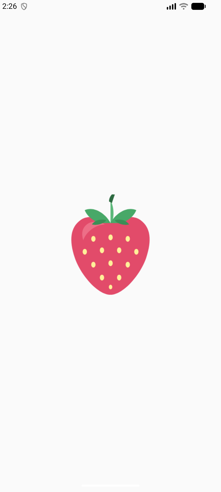
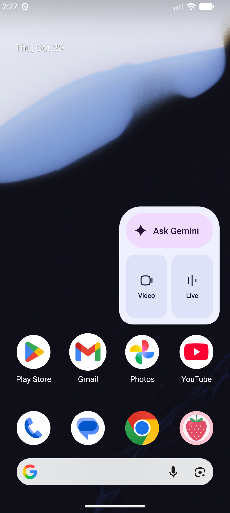
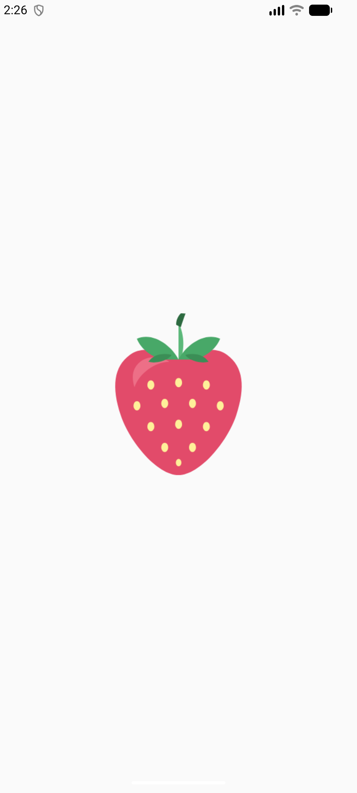
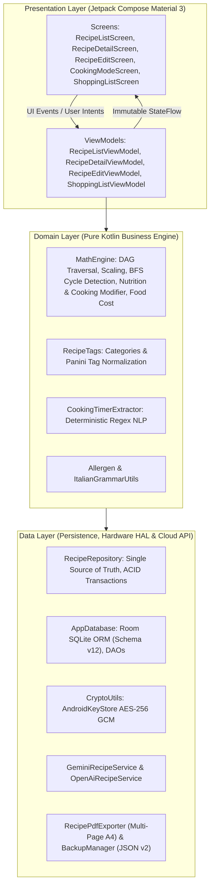

# Scalable Ingredient Management Organizer (SIMO 2.0)

> **Scalable Ingredient Management Organizer** (**SIMO 2.0**) è un'applicazione Android concepita per chef, maestri pasticceri, laboratori di panificazione artigianale e appassionati esigenti. Nasce dalla richiesta reale di un maestro pasticcere di disporre di uno strumento avanzato per il calcolo proporzionale delle dosi, delle rese in cottura e del food cost. SIMO modella il ricettario come un grafo matematico gerarchico ad albero (DAG), offrendo scalatura dinamica lineare e inversa (*reverse scaling*), calcolo analitico del food cost al centesimo, tracciabilità normativa rigorosa dei 14 allergeni alimentari, etichetta con dichiarazione nutrizionale europea (Regolamento UE 1169/2011), cooking mode a schermo sempre attivo con timer multipli concorrenti resilienti in background, lista della spesa intelligente con aggregazione automatica, esportazione di schede tecniche professionali in formato PDF multipagina A4 e assistenza culinaria generativa bivalente con Google Gemini AI e OpenAI ChatGPT.

---

## Indice Generale della Documentazione
1. [Guida all'Installazione](#guida-allinstallazione)
   * [Requisiti di Sistema](#requisiti-di-sistema)
   * [Installazione Diretta tramite APK (Sideloading)](#installazione-diretta-tramite-apk-sideloading)
   * [Installazione Rapida via ADB (Android Debug Bridge)](#installazione-rapida-via-adb-android-debug-bridge)
   * [Differenza tra SIMO-release.apk e SIMO-debug.apk](#differenza-tra-simo-releaseapk-e-simo-debugapk)
   * [Compilazione dal Codice Sorgente (Per Sviluppatori)](#compilazione-dal-codice-sorgente-per-sviluppatori)
2. [Manuale d'Istruzioni e Guida all'Uso (Versione 2.0)](#manuale-distruzioni-e-guida-alluso-versione-20)
   * [1. Benvenuti in SIMO 2.0](#1-benvenuti-in-simo-20)
   * [2. Esplorare il Ricettario e la Schermata Home](#2-esplorare-il-ricettario-e-la-schermata-home)
   * [3. Creazione e Modifica delle Ricette](#3-creazione-e-modifica-delle-ricette)
   * [4. Il Cuore di SIMO: Scaling, Cottura e Reverse Scaling](#4-il-cuore-di-simo-scaling-cottura-e-reverse-scaling)
   * [5. Dichiarazione Nutrizionale UE, Allergeni e Food Cost](#5-dichiarazione-nutrizionale-ue-allergeni-e-food-cost)
   * [6. Cooking Mode e Timer Multipli Integrati](#6-cooking-mode-e-timer-multipli-integrati)
   * [7. Lista della Spesa Intelligente](#7-lista-della-spesa-intelligente)
   * [8. Assistente Chef AI, Stampa PDF Multipagina e Backup](#8-assistente-chef-ai-stampa-pdf-multipagina-e-backup)
3. [Manuale Tecnico e Architettura di Sistema (Versione 2.0)](#manuale-tecnico-e-architettura-di-sistema-versione-20)
   * [1. Introduzione e Requisiti](#1-introduzione-e-requisiti)
   * [2. Architettura del Software e Pattern Architetturali](#2-architettura-del-software-e-pattern-architetturali)
   * [3. Domain Engine: Teoria dei Grafi, Nutrizione e Calcolo Matematico](#3-domain-engine-teoria-dei-grafi-nutrizione-e-calcolo-matematico)
   * [4. Strato Dati, Room Database e Persistenza Reattiva](#4-strato-dati-room-database-e-persistenza-reattiva)
   * [5. Integrazione Cloud AI: Dual-Engine Google Gemini & OpenAI ChatGPT](#5-integrazione-cloud-ai-dual-engine-google-gemini--openai-chatgpt)
   * [6. Rendering Grafico e Generazione PDF Multipagina](#6-rendering-grafico-e-generazione-pdf-multipagina)
   * [7. Sottosistema di Backup, Serializzazione JSON e Risoluzione Conflitti](#7-sottosistema-di-backup-serializzazione-json-e-risoluzione-conflitti)
   * [8. Testing, Validazione e Qualità del Codice](#8-testing-validazione-e-qualità-del-codice)

---

# Guida all'Installazione

In questa sezione vengono descritti i requisiti hardware e software, le modalità operative di installazione autonoma dei pacchetti precompilati APK su dispositivi Android (sia manuale via file manager sia automatizzata via ADB) e le istruzioni di compilazione per sviluppatori.

### Requisiti di Sistema
* **Sistema Operativo:** Android 8.0 (Oreo, API Level 26) o versioni successive (pienamente verificato e ottimizzato per Android 14 e Android 15 / API Level 35+).
* **Architetture Supportate:** ARM64 (`arm64-v8a`), ARMv7 (`armeabi-v7a`), x86 e x86_64.
* **Memoria RAM:** Minimo 2 GB (consigliati 3 GB o superiori per calcoli DAG estesi e rendering reattivo a 60 FPS).
* **Spazio su Disco:** Circa 75 MB per l'installazione dell'applicazione e archiviazione del database locale SQLite (Room).

### Installazione Diretta tramite APK (Sideloading)
L'applicazione è distribuita direttamente come pacchetto APK firmato, consentendo l'installazione autonoma senza necessità del Google Play Store:

1. **Scaricare il pacchetto APK:**
   * Copiare o scaricare sul dispositivo Android il file `SIMO-release.apk` (consigliato per la produzione) oppure `SIMO-debug.apk`.
2. **Abilitare l'installazione da origini sconosciute:**
   * Toccando il file APK scaricato dal browser o dal gestore file di sistema, Android presenterà un avviso di sicurezza.
   * Premere **Impostazioni** nel popup e attivare la spunta **Consenti da questa origine** per autorizzare il browser o il file manager a installare pacchetti esterni.
3. **Completare l'installazione:**
   * Tornare alla schermata precedente e toccare **Installa**.
   * Al termine dell'operazione, toccare **Apri** per avviare SIMO.

> [!NOTE]
> **Avviso Google Play Protect:**  
> Il pacchetto di produzione `SIMO-release.apk` è firmato crittograficamente con il Keystore personale dello sviluppatore (RSA 2048-bit, schemi di firma v1, v2 e v3, emesso a nome di *Francesco Panattoni, SIMO*). Trattandosi di un'installazione autonoma esterna, Play Protect potrebbe mostrare la schermata *"App di sviluppatore sconosciuto"*. È sufficiente premere **Ulteriori dettagli** e confermare con **Installa comunque**.

### Installazione Rapida via ADB (Android Debug Bridge)
Se il dispositivo Android è connesso al computer con il debug USB abilitato, o se si utilizza un emulatore, l'installazione può essere completata con un unico comando da terminale:

```powershell
# Installazione del pacchetto di produzione Release (consigliato)
adb install -r SIMO-release.apk

# Oppure installazione della variante Debug
adb install -r SIMO-debug.apk
```

Il flag `-r` consente di reinstallare l'applicazione mantenendo inalterati i dati del database locale SQLite e le preferenze dell'utente.

### Differenza tra SIMO-release.apk e SIMO-debug.apk

| Proprietà | `SIMO-release.apk` (Consigliato per l'Uso Quotidiano) | `SIMO-debug.apk` (Sviluppo e Diagnostica) |
|---|---|---|
| **Ottimizzazione R8 / ProGuard** | **Abilitata:** Codice ottimizzato, minificato, dead-code rimosso e desugaring Java 8+ attivo. | **Disabilitata:** Conserva i simboli di debug completi e le tabelle di riga. |
| **Prestazioni di Esecuzione** | Massima velocità di calcolo matematico, rendering Compose a 60 FPS fluido e privo di jank. | Minore fluidità dovuta al tracciamento di debug a runtime. |
| **Dimensione Pacchetto** | Circa **8–12 MB** (snello ed efficiente). | Circa **25–35 MB** (più voluminoso). |
| **Firma Crittografica** | Keystore ufficiale di produzione con chiave RSA-2048 certificata (*Francesco Panattoni*). | Chiave standard `androiddebugkey` generata dal toolchain Gradle locale. |
| **Destinazione d'Uso** | Dispositivo personale, banco di lavoro del laboratorio, produzione. | Test su emulatore, diagnostica Logcat, ispezione del database con Android Studio. |

### Compilazione dal Codice Sorgente (Per Sviluppatori)
Per compilare il progetto partendo dal codice sorgente:

1. **Prerequisiti:**
   * **Git** installato.
   * **JDK 17** o superiore (es. OpenJDK 17, Eclipse Temurin 17).
   * **Android Studio** (Koala, Ladybug o versioni successive) con Android SDK Platforms 26–35 installati.
2. **Clonazione della Repository:**
   ```bash
   git clone https://github.com/tuo-username/SIMO.git
   cd SIMO
   ```
3. **Esecuzione dei Test Unitari e Compilazione via Gradle:**
   * **Su Windows (PowerShell):**
     ```powershell
     # Esecuzione della suite completa di 59 test unitari
     .\gradlew.bat testDebugUnitTest

     # Compilazione pacchetti APK
     .\gradlew.bat assembleRelease
     .\gradlew.bat assembleDebug
     ```
   * **Su Linux / macOS:**
     ```bash
     chmod +x gradlew
     ./gradlew testDebugUnitTest
     ./gradlew assembleRelease
     ```
4. **Locazione dei file generati:**
   * Release APK: `app/build/outputs/apk/release/app-release.apk`
   * Debug APK: `app/build/outputs/apk/debug/app-debug.apk`

---

# Manuale d'Istruzioni e Guida all'Uso (Versione 2.0)

## 1. Benvenuti in SIMO 2.0

**SIMO** (*Scalable Ingredient Management Organizer*) nasce per rispondere in modo scientifico, elegante ed intuitivo a un'esigenza fondamentale di chiunque operi in cucina, in pasticceria o in un laboratorio artigianale: **il calcolo proporzionale e analitico delle dosi, delle rese e dei costi**.

Spesso i ricettari tradizionali presentano formulazioni calibrate su dosi fisse (ad esempio una torta per 8 persone o un impasto per 500 g di farina), ma le reali esigenze produttive sono mutevoli: un banchetto con 45 invitati, una fornitura di 80 cornetti, oppure una dispensa in cui sono rimasti solo 130 g di burro o 2 uova. Inoltre, la moderna legislazione alimentare europea (Regolamento UE 1169/2011) impone una trasparenza rigorosa sia sugli **allergeni** sia sulla **dichiarazione nutrizionale** obbligatoria dei prodotti finiti.

### Le Caratteristiche e Innovazioni di SIMO 2.0
SIMO non è un semplice taccuino di appunti, bensì un sofisticato **motore matematico e relazionale a grafo (DAG)**:
* **Ricalcolo Dinamico Diretto (Scaling):** Modifichi la resa (es. porzioni, pezzi, grammi) e tutti gli ingredienti si aggiornano istantaneamente con precisione decimale.
* **Modificatore Peso e Resa in Cottura:** Imposti la variazione di peso subita durante la cottura (calo peso negativo per evaporazione nel forno come per torte e carni, oppure aumento di massa positivo per assorbimento d'acqua come per pasta e riso).
* **Dichiarazione Nutrizionale UE Integrata (Reg. UE 1169/2011):** Tabella nutrizionale completa con i 6 valori fondamentali (Calorie, Carboidrati, Grassi, Proteine, Acqua, Sodio e Sale equivalente calcolato), espressi sia per 100 g sia per singola porzione di prodotto finito cotto.
* **Reverse Scaling dalla Dispensa:** Inserisci la quantità dell'ingrediente limitante rimasto in magazzino e SIMO riparametra l'intera ricetta a ritroso.
* **Sotto-Ricette Gerarchiche a Cascata (DAG):** Colleghi preparazioni base (es. *Crema Pasticcera*) all'interno di ricette composte (es. *Cornetto alla Crema*). La scalatura e gli allergeni si propagano automaticamente lungo l'intero albero matematico.
* **Food Cost al Centesimo ed Equivalenza Culinaria:** Calcolo in tempo reale del costo totale dell'impasto e del costo industriale per singola porzione, con conversioni metriche automatiche ($g \leftrightarrow kg$, $ml \leftrightarrow l$) ed equivalenza culinaria massa-volume 1:1.
* **Esportazione PDF Professionale A4 (Minimo 2 Pagine):** Genera schede tecniche vettoriali di laboratorio: Pagina 1 con metadati, ingredienti, food cost, allergeni e tabella nutrizionale UE; Pagina 2 con il procedimento di preparazione ad alta visibilità in nero pieno.
* **Cooking Mode Protetta:** Schermo sempre attivo (*Keep Screen On*) e timer multipli concorrenti con estrazione automatica dei tempi dalle istruzioni.
* **Assistente Chef AI Bivalente (Gemini & ChatGPT):** Generazione completa, completamento intelligente delle dosi mancanti e stima nutrizionale non-distruttiva, con preservazione dell'unità di misura desiderata (es. *torta*, *bicchieri*, *panini*).
* **Nuova Categoria Predefinita Panini:** Categoria gastronomica dedicata per la panificazione e la paninoteca artigianale.

---

## 2. Esplorare il Ricettario e la Schermata Home

All'avvio dell'applicazione verrai accolto dalla schermata principale, disegnata secondo una palette di colori pastello morbidi (*Soft Macaron*) che garantisce un contrasto ideale sia alla luce naturale del laboratorio sia in ambienti di cottura. Grazie al motore di pre-caricamento asincrono immediato, l'intero ricettario viene popolato istantaneamente, eliminando qualsiasi schermata bianca transitoria.


### 2.1 Comprendere la Scheda di ciascuna Ricetta
Ogni elemento del ricettario mostra a colpo d'occhio i dati fondamentali:
* **Nome e Descrizione Culinaria:** Il titolo della ricetta e un breve riassunto delle sue caratteristiche organolettiche e procedurali.
* **Badge Categoria (`Dolci`, `Pizze`, `Panini`, `Primi`):** Segnala la tipologia di preparazione e permette il filtraggio tematico con un tocco.
* **Badge Resa Base:** Indica le dosi originali registrate (ad esempio *Resa base: 8 porzioni*, *10 cornetti* oppure *500 g*).
* **Icona Preferiti (Stella):** Con un semplice tocco sulla stella puoi contrassegnare o rimuovere qualsiasi ricetta dai tuoi preferiti.
* **Pulsanti Rapidi:** L'icona **Matita** apre la modifica della ricetta, il **Cestino** consente l'eliminazione sicura (con salvaguardia delle ricette correlate) e il pulsante **Vedi Ricetta** conduce direttamente alla console di dettaglio e ricalcolo.

### 2.2 Ricerca, Categorie Predefinite e Ordinamento
Nella barra superiore (*Top Bar*) trovi tutti gli strumenti per gestire il catalogo:
1. **Barra Scorrevole delle Categorie:** Include le categorie predefinite dell'applicazione (*Dolci, Pizze, Panetteria, Panini, Antipasti, Primi, Secondi, Contorni, Zuppe, Alcolici, Analcolici, Caffetteria*) oltre a eventuali tag personalizzati, ordinati alfabeticamente. Toccando un tag, il ricettario mostra solo le preparazioni corrispondenti.
2. **Icona Ordinamento ($\equiv$):** Permette di visualizzare le ricette secondo diversi criteri:
   * *Dalla A alla Z* / *Dalla Z alla A* (ordine alfabetico);
   * *Dal più recente* / *Dal meno recente* (ordine cronologico);
   * *Solo Preferiti* (mostra unicamente le preparazioni contrassegnate con la stella).
3. **Campo di Ricerca Testuale:** Digitando una parola, il catalogo filtra all'istante le ricette per corrispondenza nel titolo o negli ingredienti.



---

## 3. Creazione e Modifica delle Ricette

SIMO 2.0 offre un ambiente di redazione avanzato, accessibile tramite il pulsante circolare **[+]** nella schermata principale oppure toccando la **Matita** su una ricetta esistente.


### 3.1 Dati Generali e Modificatore Peso in Cottura
Nella prima sezione della scheda è possibile impostare:
* **Nome della Ricetta:** Titolo formale della preparazione.
* **Categoria e Tag:** Selezione rapida tra i tag ufficiali (compreso *Panini*) o inserimento di una categoria personalizzata.
* **Resa Base e Unità di Resa:** La quantità di riferimento (es. *4 porzioni*, *1 torta*, *2 bicchieri*, *6 panini*).
* **Modificatore Peso in Cottura (%):** Campo fondamentale introdotto in SIMO 2.0. Permette di registrare la percentuale di variazione della massa durante il trattamento termico:
  * **Valori Negativi (Calo Peso):** Es. `-10%` per torte e crostate, `-15%` per arrosti o `-8%` per creme da pasticceria che perdono acqua per evaporazione in forno o sul fornello.
  * **Valori Positivi (Resa/Aumento di Massa):** Es. `+120%` per pasta secca o riso che assorbono liquidi durante la bollitura raddoppiando o triplicando il proprio peso iniziale.
  * **Valore Neutro (0%):** Per preparazioni a crudo, cocktail o piatti freddi senza variazione ponderale.

### 3.2 Inserimento e Gestione dei 6 Valori Nutrizionali
Toccando ciascun ingrediente, si accede alla configurazione analitica dettagliata:
Oltre al nome, alla dose, al costo commerciale e ai 14 allergeni, per ogni ingrediente è possibile registrare i **6 parametri nutrizionali ufficiali per 100 g**:
1. **Calorie (kcal):** Valore energetico espresso in chilocalorie.
2. **Carboidrati (g):** Contenuto di glucidi per 100 g.
3. **Grassi (g):** Contenuto lipidico per 100 g.
4. **Proteine (g):** Quota proteica per 100 g.
5. **Acqua / Umidità Residua (g):** Grammi d'acqua presenti in 100 g di prodotto.
6. **Sodio (mg):** Milligrammi di sodio (da cui SIMO calcola automaticamente l'equivalente in sale: $\text{Sale} = \text{Sodio [g]} \times 2.5$).

### 3.3 Banner Assistente AI: Calcola Nutrizione vs Completa Dosi
Nella parte superiore dell'editor è collocato il banner dell'Assistente AI. Toccando **Apri Assistente AI** si apre la finestra di dialogo operativa:
* **Calcola Valori Nutrizionali:** Analizza gli ingredienti già presenti e calcola esclusivamente i 6 valori nutrizionali per 100 g basandosi su tabelle ufficiali (CREA / USDA). **Non modifica né cancella** le pesature, i costi unitari e gli allergeni precedentemente inseriti!
* **Completa Dosi Mancanti:** Perfeziona la ricetta bilanciando grammature, costi, allergeni e valori nutrizionali per gli ingredienti privi di dose, senza aggiungere o rimuovere ingredienti.
* **Genera Ricetta Completa:** Genera da zero l'intera ricetta (dosi, costi, allergeni, valori nutrizionali, calo peso e passaggi numerati).


---

## 4. Il Cuore di SIMO: Scaling, Cottura e Reverse Scaling

Nel dettaglio di ogni ricetta risiede il cruscotto di calcolo proporzionale in tempo reale.


### 4.1 Controller di Resa e Variazione Peso in Cottura
Il pannello **Ricalcolo Dinamico** unifica la scalatura delle porzioni con la fisica della cottura:
* I pulsanti **[–]** e **[+]** consentono di variare la resa con visualizzazione del moltiplicatore scalare (es. **1.00x**, **2.50x**).
* **Confronto Crudo vs Cotto:** Il box mostra sia il peso totale dell'impasto crudo sommato prima della lavorazione (es. *Impasto crudo: 618 g*), sia il peso del prodotto finito dopo la cottura (es. *Cotto finito: 568.56 g* con calo dell'8%).
* **Resa Cotta a Porzione:** SIMO indica il peso netto stimato di ciascuna singola porzione cotta finita (es. *~71 g a porzione*).

### 4.2 Reverse Scaling dalla Dispensa
Se disponi di una quantità limitata di una materia prima (ad esempio 120 g di burro anziché 175 g):
1. Tocca la pillola con la quantità dell'ingrediente vincolante;
2. Inserisci la quantità effettivamente disponibile e conferma;
3. L'intero albero di componenti e la resa totale si riparametreranno all'istante attorno a quel vincolo.

### 4.3 Sotto-Ricette Gerarchiche a Cascata
Nel *Cornetto alla Crema*, la preparazione richiede la *Crema Pasticcera*. SIMO la tratta come una sotto-ricetta collegata: espandendo la card è possibile visualizzare i componenti interni (latte, tuorli, amido) con le dosi ricalcolate per la quantità di crema necessaria ai cornetti.

---

## 5. Dichiarazione Nutrizionale UE, Allergeni e Food Cost

### 5.1 Scheda Nutrizionale Grafica UE (Regolamento UE 1169/2011)
In fondo alla schermata di dettaglio, sotto la lista degli ingredienti e degli allergeni, compare la nuova **Dichiarazione Nutrizionale Grafica UE**:


* **Dicitura Ufficiale di Stima:** L'intestazione riporta chiaramente la dicitura *"DICHIARAZIONE NUTRIZIONALE (Stima – Reg. UE n. 1169/2011)"*.
* **Doppia Colonna di Riferimento:** I valori medi sono suddivisi su due colonne: **Per 100 g** e **Per Porzione** (con peso esatto della porzione cotta finita).
* **Protezione Tipografica Monoriga per l'Energia:** La riga dell'energia riporta congiuntamente i valori in **kJ** e in **kcal** (es. *984 kJ / 235 kcal*) formattati per non andare mai a capo o subire troncamenti.
* **I 7 Parametri Standard UE:** Energia, Grassi, Carboidrati, Proteine, Sale equivalente (derivato dal Sodio moltiplicato per 2.5), Sodio e Acqua (umidità residua).
* **Concentrazione Nutrienti con Modificatore Cottura:** I valori per 100 g tengono conto dell'evaporazione d'acqua in cottura: se l'impasto perde il 10% d'acqua, i macronutrienti nei 100 g di prodotto finito risulteranno proporzionalmente concentrati, riflettendo la reale chimica alimentare!

### 5.2 Allergeni Normativi UE e Food Cost al Centesimo
* **14 Allergeni UE:** Evidenziati con chip colorati e badge monoriga protetti (*Allergene #N*), ereditati ricorsivamente da tutte le sotto-ricette.
* **Food Cost in Tempo Reale:** Calcola il costo totale dell'impasto e il costo a porzione/pezzo con equivalenza culinaria 1:1 per densità unitaria ($1\,\text{g} = 1\,\text{ml}$ e $1\,\text{kg} = 1\,\text{l}$), prevenendo distorsioni di prezzo quando i liquidi (es. latte, caffè, panna) vengono dosati in millilitri ma tariffati in litri o chilogrammi.

---

## 6. Cooking Mode e Timer Multipli Integrati

La **Cooking Mode** trasforma SIMO in un cruscotto operativo da banco per la preparazione attiva.

| Cooking Mode a Schermo Attivo | Regolazione Rapida Timer |
|:---:|:---:|
|  |  |

* **Schermo Sempre Attivo (*Keep Screen On*):** Nessun blackout del display mentre le mani sono sporche o bagnate.
* **Checklist di Pesatura e Passaggi:** Caselle di spunta rapide per segnare gli ingredienti pesati e le fasi procedurali completate.
* **Riconoscimento Automatico dei Timer nel Testo:** Frasi come *"infornare per 35 minuti"* o *"cuocere per 12 minuti"* generano pulsanti interattivi immediati con il conto alla rovescia preimpostato.
* **Resilienza in Background con Foreground Service:** Puoi cambiare app (es. guardare un tutorial su YouTube o rispondere al telefono): i timer continuano a scorrere e suoneranno con allarme acustico e vibrazione allo scadere.


---

## 7. Lista della Spesa Intelligente

Accessibile dal menu superiore o direttamente dal dettaglio ricetta tramite il tasto verde **Aggiungi a Spesa**:


* **Aggregazione Automatica:** Se più ricette utilizzano lo stesso ingrediente con la stessa unità, le quantità vengono unificate in una sola riga (es. $200\,\text{g} + 150\,\text{g} = 350\,\text{g}$ di burro).
* **Stima del Costo Totale della Spesa:** Calcola in tempo reale la spesa economica complessiva convertendo automaticamente i prezzi registrati al chilogrammo o al litro.
* **Gestione Articoli "q.b.":** Gli articoli a dose libera adottano un quantitativo d'acquisto standard (100 g o 1 unità) per agevolare l'approvvigionamento al supermercato.

---

## 8. Assistente Chef AI, Stampa PDF Multipagina e Backup

### 8.1 Assistente Chef AI Bivalente (Gemini & ChatGPT)
SIMO 2.0 integra nativamente due motori di intelligenza artificiale: **Google Gemini** e **OpenAI ChatGPT**.



* **Preservazione Intelligente dell'Unità di Resa:** Quando imposti un'unità personalizzata (es. *torta*, *bicchieri*, *panini*, *fette*, *crostate*), l'AI valuta la coerenza culinaria con la ricetta richiesta:
  * Se l'unità è congruente (es. *torta* per una cheesecake, *bicchieri* per un cocktail o un frappè, *panini* per burger o panini), l'AI **mantiene la tua unità** e calibra le dosi su di essa!
  * Solo se l'unità è palesemente priva di senso gastronomico (es. *bicchieri* per una pizza o un risotto), l'AI torna a *porzioni*.
* **Valori Realistici e Bilanciati:** I prompt di sistema impongono il massimo rigore gastronomico, dosaggi calibrati, prezzi di mercato italiani e valori nutrizionali fedeli.
* **Sicurezza Hardware-Backed AES-256 GCM:** Le tue chiavi API di Google ed OpenAI sono crittografate nel chip hardware sicuro (*Android KeyStore*) del dispositivo e non vengono mai esportate nei backup.

### 8.2 Esportazione PDF Professionale A4 (Minimo 2 Pagine)
Dalla scheda di dettaglio, toccando l'icona **PDF**, SIMO genera un documento A4 stampabile:
* **Minimo 2 Pagine Garantito:**
  * **Pagina 1:** Intestazione SIMO, data, resa e porzioni, tabella delle materie prime scalate, box Food Cost, tabella degli allergeni UE e la dichiarazione nutrizionale UE completa;
  * **Pagina 2 (e successive):** Interamente dedicata al **Procedimento di Preparazione**, stampato con testo in nero pieno nitido ad alto contrasto per la massima leggibilità sul banco di lavoro.
* Condivisione immediata tramite WhatsApp, Telegram, email, Google Drive o stampa diretta Wi-Fi.

### 8.3 Backup e Ripristino JSON con Risoluzione Conflitti
Dalla barra principale puoi esportare l'intero archivio in un file standard `.json` (schema versione 2) contenente tutti i valori nutrizionali, i costi e i modificatori di cottura. Al momento del ripristino su un nuovo telefono, SIMO ti consentirà di risolvere individualmente ogni eventuale conflitto tra ricette nuove ed esistenti.

---

# Manuale Tecnico e Architettura di Sistema (Versione 2.0)

## 1. Introduzione e Requisiti

### 1.1 Problem Statement & Contesto di Dominio
Nei moderni processi di preparazione culinaria professionale, alta pasticceria e panificazione artigianale, la modellazione e la gestione computazionale delle ricette eccedono largamente le capacità dei sistemi tabellari tradizionali:
1. **Gerarchie Multi-Livello (Composite Recipes):** Le ricette composte non sono elenchi piatti di materie prime, bensì aggregati strutturati di sotto-ricette intermedie (*sotto-ricette*). Qualsiasi modifica alla composizione o alla resa base di una preparazione intermedia deve propagarsi deterministicamente all'intero grafo orientato di composizione.
2. **Modellazione Termica e Resa in Cottura:** Le preparazioni subiscono variazioni di massa in cottura: calo peso per evaporazione termica nei prodotti da forno e carni, oppure aumento di massa per assorbimento liquido in pasta e riso. Tale variazione condiziona sia la resa finale sia la concentrazione di nutrienti per 100 g.
3. **Dichiarazione Nutrizionale Normativa UE (Regolamento UE 1169/2011):** Obbligo di quantificare accuratamente i valori nutrizionali medi (Energia kJ/kcal, Grassi, Carboidrati, Proteine, Acqua, Sodio e Sale equivalente) calcolati sul prodotto finito cotto.
4. **Inversione di Scala da Vincolo di Dispensa (Reverse Scaling):** Capacità di ricalcolare l'intera ricetta a ritroso vincolando il moltiplicatore scalare alla quantità limitata di una singola materia prima disponibile in magazzino.
5. **Tracciabilità Normativa degli Allergeni:** Rilevamento automatico e risalita ad albero dei 14 allergeni normativi europei.
6. **Food Cost Contabile ed Equivalenza Culinaria:** Quantificazione del costo del lotto e per singola porzione, con conversioni metriche automatiche e gestione coerente dell'equivalenza densità unitaria ($g \leftrightarrow ml$, $kg \leftrightarrow l$).
7. **Esportazione Documentale Vettoriale Multipagina:** Generazione di schede tecniche A4 con partizione semantica (almeno 2 pagine garantite) e contrasto tipografico assoluto per la produzione in laboratorio.
8. **Integrazione Cloud AI Bivalente (Gemini & OpenAI):** Compilazione automatica e non-distruttiva, con preservazione dell'unità di resa dell'utente e sicurezza hardware-backed TEE.

### 1.2 Requisiti Non Funzionali e Vincoli Architetturali
* **Offline-First:** Funzionamento autonomo e deterministico a latenza zero in assenza di rete per tutte le funzioni di calcolo, persistenza e cottura.
* **Complessità Temporale di Ricalcolo:** Complessità $O(|V| + |E|)$ rispetto al grafo di composizione, con tempo di re-rendering $\le 16\text{ ms}$ a 60 FPS.
* **Integrità Aciclica Formale:** Garanzia che il grafo rimanga in ogni istante un **Grafo Diretto Aciclico (DAG)**.

---

## 2. Architettura del Software e Pattern Architetturali

SIMO 2.0 adotta una combinazione rigorosa di **Clean Architecture** e **Model-View-ViewModel (MVVM)**, orchestrata mediante il pattern **Unidirectional Data Flow (UDF)** di Jetpack Compose.



### 2.1 Unidirectional Data Flow (UDF) e State Immutability
Ogni schermata applicativa è funzione pura dello stato corrente (*State-Driven UI*):
$$\text{UI} = f(\text{UiState})$$
I ViewModel non espongono variabili mutabili pubbliche: ogni transizione di stato avviene tramite istanze di data class immutabili incapsulate in `StateFlow<T>`.

### 2.2 Concorrenza e Thread Safety
L'esecuzione è rigorosamente segregata sui dispatcher Kotlin:
* `Dispatchers.Main`: Binding reattivo Compose a 60 FPS;
* `Dispatchers.Default`: Attraversamento grafo DAG, calcolo nutrizionale e bilanciamento dosi;
* `Dispatchers.IO`: Query Room SQLite, I/O crittografico, client HTTPS REST e serializzazione PDF/JSON.

---

## 3. Domain Engine: Teoria dei Grafi, Nutrizione e Calcolo Matematico

Il modulo `MathEngine.kt` è implementato come modulo Kotlin puro privo di dipendenze verso il framework Android.

### 3.1 Formalizzazione del Ricettario come DAG Pesato
Sia $G = (V, E, W)$ un grafo orientato pesato finito privo di cicli:
$$\forall v \in V, \quad \nexists \text{ cammino orientato } v \rightsquigarrow v \iff G \text{ è un DAG}$$
dove $V = V_{\text{raw}} \cup V_{\text{recipe}}$ e $E \subseteq V_{\text{recipe}} \times V$.
Il peso dell'arco modella la quantità base $q$ e l'unità $u$.

### 3.2 Algoritmo di Rilevamento Cicli Preventivo (`wouldCreateCycle`)
Prima di consentire l'inserimento o la modifica di un arco $(u, v)$ dove $u$ è la ricetta genitore e $v$ è la ricetta figlia candidata, il sistema valuta se esiste un cammino diretto $v \rightsquigarrow u$ tramite BFS ottimizzata con complessità $O(|V| + |E|)$.

### 3.3 Modello Matematico dei Valori Nutrizionali e Concentrazione in Cottura
Ciascun ingrediente base $i \in V_{\text{raw}}$ è caratterizzato da un vettore nutrizionale per 100 g di materia prima cruda:
$$\vec{N}_i = \begin{pmatrix} C_i \\ K_i \\ F_i \\ P_i \\ W_i \\ S_i \end{pmatrix} = \begin{pmatrix} \text{Calorie [kcal]} \\ \text{Carboidrati [g]} \\ \text{Grassi [g]} \\ \text{Proteine [g]} \\ \text{Acqua [g]} \\ \text{Sodio [mg]} \end{pmatrix}$$

Dato un albero scalato con insieme di foglie $c \in \text{Foglie}(R)$, ciascuna avente massa scalata $m(c)$ (convertita in grammi con densità unitaria per i millilitri), l'apporto assoluto del componente è:
$$\vec{N}_{\text{tot}}(c) = \frac{m(c)}{100} \cdot \vec{N}_{\text{item}(c)}$$

La massa totale cruda $W_{\text{raw}}$ e la massa cotta finita $W_{\text{cooked}}$ sono definite da:
$$W_{\text{raw}} = \sum_{c \in \text{Foglie}} m(c)$$
$$W_{\text{cooked}} = W_{\text{raw}} \cdot \left(1 + \frac{\gamma}{100}\right), \quad \text{con } \gamma = \text{cookingWeightModifier} \in (-100, +\infty)$$

#### Legge di Concentrazione dei Nutrienti in Cottura
I valori nutrizionali medi per 100 g di prodotto finito cotto sono calcolati normalizzando la somma assoluta dei nutrienti rispetto alla massa cotta effettiva:
$$\vec{N}_{100\text{g}} = \frac{\sum_{c \in \text{Foglie}} \vec{N}_{\text{tot}}(c)}{W_{\text{cooked}}} \times 100$$
Se $\gamma < 0$ (es. evaporazione del 10%), $W_{\text{cooked}} < W_{\text{raw}}$ e la densità nutrizionale per 100 g aumenta coerentemente con la realtà termodinamica.
I valori per porzione singola sono invece indipendenti dall'evaporazione dell'acqua:
$$\vec{N}_{\text{porzione}} = \frac{\sum_{c \in \text{Foglie}} \vec{N}_{\text{tot}}(c)}{Y_{\text{target}}}$$

#### Derivazione di Energia e Sale Equivalente (Regolamento UE 1169/2011)
$$\text{Energia [kJ]} = (K \times 17) + (P \times 17) + (F \times 37)$$
$$\text{Sale Equivalente [g]} = \frac{S\text{ [mg]}}{1000} \times 2.5$$

### 3.4 Modello Analitico del Food Cost ed Equivalenza Culinaria
Il costo elementare $C(c)$ del componente scalato $c$ con quantità $q(c)$ e unità $u_r$, dato un prezzo unitario $p$ con unità commerciale $u_p$, applica l'operatore di conversione esteso con equivalenza culinaria 1:1 ($g \leftrightarrow ml$, $kg \leftrightarrow l$):
$$
\mu(u_r, u_p) = 
\begin{cases}
1 & \text{se } u_r = u_p \text{ oppure } (u_r \in \{g, ml\} \land u_p \in \{g, ml\}) \\
10^{-3} & \text{se } u_r \in \{g, ml\} \land u_p \in \{kg, l\} \\
10^3 & \text{se } u_r \in \{kg, l\} \land u_p \in \{g, ml\} \\
\frac{\text{gramsPerUnit}}{1000} & \text{se } u_r \in \{\text{unità, pz}\} \land u_p \in \{kg, l\} \\
\text{gramsPerUnit} & \text{se } u_r \in \{\text{unità, pz}\} \land u_p \in \{g, ml\} \\
0 & \text{se } u_r = \text{q.b.}
\end{cases}
$$

---

## 4. Strato Dati, Room Database e Persistenza Reattiva

### 4.1 Schema Relazionale Room (Versione 12)
Il database relazionale locale adotta Android Room SQLite con migrazione incrementale:

| Tabella | Colonne Chiave | Descrizione e Campi v2.0 |
|---|---|---|
| `items` | `id`, `name`, `type`, `defaultUnit`, `pricePerUnit`, `allergens`, **nutrizione** | Include `caloriesKcal`, `carbohydratesG`, `fatsG`, `proteinsG`, `waterG`, `sodiumMg` (REAL). |
| `recipes` | `id`, `name`, `baseYieldQuantity`, `yieldUnit`, `category`, **modificatore** | Include `cookingWeightModifier` (REAL NOT NULL DEFAULT 0.0). |
| `recipe_components` | `id`, `parentRecipeId`, `childItemId`, `baseQuantity`, `unit`, `sortOrder` | Modella gli archi orientati pesati del grafo DAG. |
| `shopping_items` | `id`, `itemName`, `quantity`, `unit`, `unitPrice`, `priceUnit`, `isChecked` | Articoli della spesa con persistenza dei prezzi unitari. |

### 4.2 Pattern di Modifica Reattiva: `EditableComponent`
In `RecipeEditViewModel.kt`, lo stato di modifica degli ingredienti è strutturato con la data class immutabile:
```kotlin
data class EditableComponent(
    val tempId: String = UUID.randomUUID().toString(),
    val itemId: String,
    val itemName: String,
    val itemType: ItemType,
    val quantity: String,
    val unit: String,
    val pricePerUnit: Double? = null,
    val priceUnit: String? = null,
    val allergens: List<Allergen> = emptyList(),
    val caloriesKcal: Double? = null,
    val carbohydratesG: Double? = null,
    val fatsG: Double? = null,
    val proteinsG: Double? = null,
    val waterG: Double? = null,
    val sodiumMg: Double? = null
)
```

---

## 5. Integrazione Cloud AI: Dual-Engine Google Gemini & OpenAI ChatGPT

SIMO 2.0 offre un'architettura modulare bivalente per l'assistenza culinaria generativa (`GeminiRecipeService.kt` e `OpenAiRecipeService.kt`), gestita dall'enum `AiProvider`.

### 5.1 Preservazione Intelligente dell'Unità di Resa (`yieldUnit`)
Nel caso in cui l'utente indichi un'unità di misura personalizzata della resa (es. *torta*, *bicchieri*, *panini*, *fette*, *crostate*), il prompt di sistema vincola il modello mediante validazione gastronomica:
```kotlin
val userUnit = yieldUnit?.trim()?.takeIf{ it.isNotBlank() } ?: "porzioni"
val prompt = buildString{
    append("Resa base e Unità richiesta: $userYieldNum $userUnit.\n")
    append("""
        IMPORTANTE SULL'UNITÀ DELLA RESA ('yieldUnit'):
        L'utente ha impostato come unità di misura: "$userUnit".
        - Se "$userUnit" ha senso culinario per la ricetta (es. 'torta' per un dolce, 'bicchieri' per una bevanda, 'panini' per burger), DEVI MANTENERE "$userUnit" nel campo 'yieldUnit' e calibrare le dosi per essa.
        - Se invece "$userUnit" non ha senso (es. 'bicchieri' per pasta o pizza), imposta 'yieldUnit' a "porzioni".
    """.trimIndent())
}
```

### 5.2 Metodi Operativi Non-Distruttivi in ViewModel
* `applyNutritionalValuesOnly`: Arricchisce i 6 parametri nutrizionali delle materie prime esistenti senza alterare quantità pesate, costi o allergeni precedentemente inseriti;
* `applyCompletedMissingIngredients`: Completa esclusivamente gli ingredienti con quantità indefinita o zero, lasciando inalterati gli altri elementi dell'impasto;
* `generateFullRecipe`: Genera l'intera composizione della ricetta da zero.

### 5.3 Sicurezza Hardware-Backed AES-256 GCM
Le chiavi API di entrambi i provider sono memorizzate nel coprocessore hardware `AndroidKeyStore` mediante algoritmo AES-256 in modalità GCM:
$$\text{Ciphertext} = \text{AES-GCM-256}_{K_{\text{hardware}}}(\text{API Key})$$

---

## 6. Rendering Grafico e Generazione PDF Multipagina

L'esportazione documentale in formato A4 (72 DPI, $595 \times 842\text{ pt}$) è implementata in `RecipePdfExporter.kt` mediante la pipeline vettoriale nativa `android.graphics.pdf.PdfDocument`.

### Partizione Semantica a Minimo 2 Pagine Garantite
* **Pagina 1 (Cruscotto Dati & Specifiche):**
  * Intestazione SIMO con data di calcolo e resa target;
  * Titolo della ricetta, categoria e Food Cost (totale e a porzione);
  * Tabella sinottica degli ingredienti con dosi scalate ed etichettatura sotto-ricette;
  * Riquadro evidenziato con i 14 allergeni normativi UE;
  * Tabella completa della **Dichiarazione Nutrizionale UE** (per 100 g e per porzione cotta finita).
* **Pagina 2 (e successive):**
  * Avvio forzato di una nuova pagina con `startNewPage()`;
  * Intestazione mini con titolo ricetta e numero di pagina;
  * Sezione **PROCEDIMENTO DI PREPARAZIONE** con passaggi numerati, word-wrapping automatico e testo renderizzato in **nero solido (`Color.BLACK`)** ad alto contrasto, eliminando qualsiasi opacità o sbiadimento ereditato dai divisori.

---

## 7. Sottosistema di Backup, Serializzazione JSON e Risoluzione Conflitti

### Specifica Canonica SIMO JSON Schema v2
La struttura di esportazione in formato JSON v2 supporta la persistenza completa di tutti i dati introdotti nella nuova versione:
```json
{
  "version": 2,
  "appName": "SIMO",
  "timestamp": 1774028400000,
  "items": [
    {
      "id": "ing_farina_00",
      "name": "Farina 00",
      "type": "RAW_INGREDIENT",
      "defaultUnit": "g",
      "pricePerUnit": 1.20,
      "priceUnit": "kg",
      "allergens": "GLUTINE",
      "caloriesKcal": 364.0,
      "carbohydratesG": 76.3,
      "fatsG": 1.0,
      "proteinsG": 10.3,
      "waterG": 14.0,
      "sodiumMg": 2.0
    }
  ],
  "recipes": [
    {
      "id": "recipe_pizza_margherita",
      "name": "Pizza Margherita",
      "baseYieldQuantity": 1.0,
      "yieldUnit": "pizza",
      "category": "Pizze",
      "cookingWeightModifier": -10.0,
      "instructions": "1. ...",
      "components": [ ... ]
    }
  ]
}
```

---

## 8. Testing, Validazione e Qualità del Codice

La qualità e l'integrità matematica di SIMO 2.0 sono garantite da una suite estesa di **59 test unitari automatizzati** eseguiti su host JVM:

| Suite di Test | N. Test | Obiettivo di Validazione |
|---|---|---|
| `NutritionMathEngineTest` | 6 test | Calcolo nutrizionale ricorsivo, concentrazione nutrienti con calo peso, resa cotta, energia kJ/kcal e sale da sodio. |
| `NutritionDatabaseAndBackupTest` | 5 test | Persistenza Room dei 6 nutrienti, migrazione schema, serializzazione e ripristino JSON v2. |
| `NutritionDefaultRecipesAndPdfTest` | 4 test | Validazione nutrizionale delle 3 ricette di default (Cornetto, Crema, Pizza) e test impaginazione PDF. |
| `RecipeTagsTest` | 3 test | Categoria predefinita *Panini*, ordinamento alfabetico dei tag e sanitizzazione case-insensitive. |
| `OpenAiRecipeServiceTest` | 4 test | Fallback modelli ChatGPT, parsing JSON nutrizionale, preservazione unità custom (*bicchieri*). |
| `GeminiRecipeServiceTest` | 4 test | Parsing JSON Gemini, mappatura flessibile allergeni, preservazione unità di resa. |
| `MathEngineTest` | 13 test | Scaling proporzionale lineare, reverse scaling, calcolo food cost ed equivalenza 1:1 g/ml e kg/l. |
| `MathEngineSafetyTest` | 4 test | Robustezza a valori non finiti ($NaN, +\infty$), divisioni per zero e aciclicità DAG. |
| `AllergenLogicTest` | 3 test | Riconoscimento 14 allergeni normativi UE ed ereditarietà ricorsiva. |
| `ItalianGrammarUtilsTest` | 8 test | Flessione singolare/plurale per etichette ricetta, unità di misura e costi. |
| `ShoppingListLogicTest` | 3 test | Aggregazione ingredienti con stessa unità, somme ponderate e stima spesa. |
| `CookingTimerExtractorTest` | 2 test | Riconoscimento regex dei timer di cottura e durate composte. |
