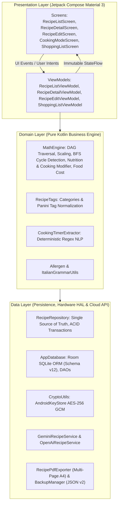

# SIMO – Manuale Tecnico e Architettura di Sistema

> **Scalable Ingredient Management Organizer (SIMO)**  
> *Versione 2.0.0 (Ottobre 2026)* – Android SDK 26–35+ (Kotlin 2.0 / Jetpack Compose M3)  
> Modello Computazionale a Grafo DAG • Motore Nutrizionale UE • Dual Cloud AI (Gemini & ChatGPT) • Vector PDF ISO 216 A4

---

## 1. Introduzione

### 1.1 Problem Statement & Contesto di Dominio
Nei moderni processi di preparazione culinaria professionale, alta pasticceria e panificazione artigianale, la modellazione e la gestione computazionale delle ricette eccedono largamente le capacità dei sistemi tabellari tradizionali:
1. **Gerarchie Multi-Livello (Composite Recipes):** Le ricette composte non sono elenchi piatti di materie prime, bensì aggregati strutturati di sotto-ricette intermedie (*sotto-ricette*). Qualsiasi modifica alla composizione o alla resa base di una preparazione intermedia deve propagarsi deterministicamente all'intero grafo orientato di composizione.
2. **Modellazione Termica e Resa in Cottura:** Le preparazioni subiscono variazioni di massa in cottura: calo peso per evaporazione termica nei prodotti da forno e carni, oppure aumento di massa per assorbimento liquido in pasta e riso. Tale variazione condiziona sia la resa finale sia la concentrazione di nutrienti per 100 g.
3. **Dichiarazione Nutrizionale Normativa UE (Regolamento UE 1169/2011):** Obbligo di quantificare accuratamente i valori nutrizionali medi (Energia kJ/kcal, Grassi, Carboidrati, Proteine, Acqua, Sodio e Sale equivalente) calcolati sul prodotto finito cotto.
4. **Inversione di Scala da Vincolo di Dispensa (Reverse Scaling):** Capacità di ricalcolare l'intera ricetta a ritroso vincolando il moltiplicatore scalare alla quantità limitata di una singola materia prima disponibile in magazzino.
5. **Tracciabilità Normativa degli Allergeni:** Rilevamento automatico e risalita ad albero dei 14 allergeni normativi europei.
6. **Food Cost Contabile ed Equivalenza Culinaria:** Quantificazione del costo del lotto e per singola porzione, con conversioni metriche automatiche e gestione coerente dell'equivalenza densità unitaria ($g \leftrightarrow ml$, $kg \leftrightarrow l$).
7. **Esportazione Documentale Vettoriale Multipagina:** Generazione di schede tecniche A4 con partizione semantica (almeno 2 pagine garantite) e contrasto tipografico assoluto per la produzione in laboratorio.
8. **Integrazione Cloud AI Bivalente (Gemini & OpenAI):** Compilazione automatica e non-distruttiva, con preservazione dell'unità di resa dell'utente e sicurezza hardware-backed TEE.

### 1.2 Requisiti Non Funzionali e Vincoli Architetturali
* **Offline-First:** Funzionamento autonomo e deterministico a latenza zero in assenza di rete per tutte le funzioni di calcolo, persistenza e cottura.
* **Complessità Temporale di Ricalcolo:** Complessità $O(|V| + |E|)$ rispetto al grafo di composizione, con tempo di re-rendering $\le 16\text{ ms}$ a 60 FPS.
* **Integrità Aciclica Formale:** Garanzia che il grafo rimanga in ogni istante un **Grafo Diretto Aciclico (DAG)**.

---

## 2. Architettura del Software e Pattern Architetturali

SIMO adotta una combinazione rigorosa di **Clean Architecture** e **Model-View-ViewModel (MVVM)**, orchestrata mediante il pattern **Unidirectional Data Flow (UDF)** di Jetpack Compose.



### 2.1 Unidirectional Data Flow (UDF) e State Immutability
Ogni schermata applicativa è funzione pura dello stato corrente (*State-Driven UI*):
$$\text{UI} = f(\text{UiState})$$
I ViewModel non espongono variabili mutabili pubbliche: ogni transizione di stato avviene tramite istanze di data class immutabili incapsulate in `StateFlow<T>`.

### 2.2 Concorrenza e Thread Safety
L'esecuzione è rigorosamente segregata sui dispatcher Kotlin:
* `Dispatchers.Main`: Binding reattivo Compose a 60 FPS;
* `Dispatchers.Default`: Attraversamento grafo DAG, calcolo nutrizionale e bilanciamento dosi;
* `Dispatchers.IO`: Query Room SQLite, I/O crittografico, client HTTPS REST e serializzazione PDF/JSON.

---

## 3. Domain Engine: Teoria dei Grafi, Nutrizione e Calcolo Matematico

Il modulo `MathEngine.kt` è implementato come modulo Kotlin puro privo di dipendenze verso il framework Android.

### 3.1 Formalizzazione del Ricettario come DAG Pesato
Sia $G = (V, E, W)$ un grafo orientato pesato finito privo di cicli:
$$\forall v \in V, \quad \nexists \text{ cammino orientato } v \rightsquigarrow v \iff G \text{ è un DAG}$$
dove $V = V_{\text{raw}} \cup V_{\text{recipe}}$ e $E \subseteq V_{\text{recipe}} \times V$.
Il peso dell'arco modella la quantità base $q$ e l'unità $u$.

### 3.2 Algoritmo di Rilevamento Cicli Preventivo (`wouldCreateCycle`)
Prima di consentire l'inserimento o la modifica di un arco $(u, v)$ dove $u$ è la ricetta genitore e $v$ è la ricetta figlia candidata, il sistema valuta se esiste un cammino diretto $v \rightsquigarrow u$ tramite BFS ottimizzata con complessità $O(|V| + |E|)$.

### 3.3 Modello Matematico dei Valori Nutrizionali e Concentrazione in Cottura
Ciascun ingrediente base $i \in V_{\text{raw}}$ è caratterizzato da un vettore nutrizionale per 100 g di materia prima cruda:
$$\vec{N}_i = \begin{pmatrix} C_i \\ K_i \\ F_i \\ P_i \\ W_i \\ S_i \end{pmatrix} = \begin{pmatrix} \text{Calorie [kcal]} \\ \text{Carboidrati [g]} \\ \text{Grassi [g]} \\ \text{Proteine [g]} \\ \text{Acqua [g]} \\ \text{Sodio [mg]} \end{pmatrix}$$

Dato un albero scalato con insieme di foglie $c \in \text{Foglie}(R)$, ciascuna avente massa scalata $m(c)$ (convertita in grammi con densità unitaria per i millilitri), l'apporto assoluto del componente è:
$$\vec{N}_{\text{tot}}(c) = \frac{m(c)}{100} \cdot \vec{N}_{\text{item}(c)}$$

La massa totale cruda $W_{\text{raw}}$ e la massa cotta finita $W_{\text{cooked}}$ sono definite da:
$$W_{\text{raw}} = \sum_{c \in \text{Foglie}} m(c)$$
$$W_{\text{cooked}} = W_{\text{raw}} \cdot \left(1 + \frac{\gamma}{100}\right), \quad \text{con } \gamma = \text{cookingWeightModifier} \in (-100, +\infty)$$

#### Legge di Concentrazione dei Nutrienti in Cottura
I valori nutrizionali medi per 100 g di prodotto finito cotto sono calcolati normalizzando la somma assoluta dei nutrienti rispetto alla massa cotta effettiva:
$$\vec{N}_{100\text{g}} = \frac{\sum_{c \in \text{Foglie}} \vec{N}_{\text{tot}}(c)}{W_{\text{cooked}}} \times 100$$
Se $\gamma < 0$ (es. evaporazione del 10%), $W_{\text{cooked}} < W_{\text{raw}}$ e la densità nutrizionale per 100 g aumenta coerentemente con la realtà termodinamica.
I valori per porzione singola sono invece indipendenti dall'evaporazione dell'acqua:
$$\vec{N}_{\text{porzione}} = \frac{\sum_{c \in \text{Foglie}} \vec{N}_{\text{tot}}(c)}{Y_{\text{target}}}$$

#### Derivazione di Energia e Sale Equivalente (Regolamento UE 1169/2011)
$$\text{Energia [kJ]} = (K \times 17) + (P \times 17) + (F \times 37)$$
$$\text{Sale Equivalente [g]} = \frac{S\text{ [mg]}}{1000} \times 2.5$$

### 3.4 Modello Analitico del Food Cost ed Equivalenza Culinaria
Il costo elementare $C(c)$ del componente scalato $c$ con quantità $q(c)$ e unità $u_r$, dato un prezzo unitario $p$ con unità commerciale $u_p$, applica l'operatore di conversione esteso con equivalenza culinaria 1:1 ($g \leftrightarrow ml$, $kg \leftrightarrow l$):
$$
\mu(u_r, u_p) = 
\begin{cases}
1 & \text{se } u_r = u_p \text{ oppure } (u_r \in \{g, ml\} \land u_p \in \{g, ml\}) \\
10^{-3} & \text{se } u_r \in \{g, ml\} \land u_p \in \{kg, l\} \\
10^3 & \text{se } u_r \in \{kg, l\} \land u_p \in \{g, ml\} \\
\frac{\text{gramsPerUnit}}{1000} & \text{se } u_r \in \{\text{unità, pz}\} \land u_p \in \{kg, l\} \\
\text{gramsPerUnit} & \text{se } u_r \in \{\text{unità, pz}\} \land u_p \in \{g, ml\} \\
0 & \text{se } u_r = \text{q.b.}
\end{cases}
$$

---

## 4. Strato Dati, Room Database e Persistenza Reattiva

### 4.1 Schema Relazionale Room (Versione 12)
Il database relazionale locale adotta Android Room SQLite con migrazione incrementale:

| Tabella | Colonne Chiave | Descrizione e Campi v2.0 |
|---|---|---|
| `items` | `id`, `name`, `type`, `defaultUnit`, `pricePerUnit`, `allergens`, **nutrizione** | Include `caloriesKcal`, `carbohydratesG`, `fatsG`, `proteinsG`, `waterG`, `sodiumMg` (REAL). |
| `recipes` | `id`, `name`, `baseYieldQuantity`, `yieldUnit`, `category`, **modificatore** | Include `cookingWeightModifier` (REAL NOT NULL DEFAULT 0.0). |
| `recipe_components` | `id`, `parentRecipeId`, `childItemId`, `baseQuantity`, `unit`, `sortOrder` | Modella gli archi orientati pesati del grafo DAG. |
| `shopping_items` | `id`, `itemName`, `quantity`, `unit`, `unitPrice`, `priceUnit`, `isChecked` | Articoli della spesa con persistenza dei prezzi unitari. |

### 4.2 Pattern di Modifica Reattiva: `EditableComponent`
In `RecipeEditViewModel.kt`, lo stato di modifica degli ingredienti è strutturato con la data class immutabile:
```kotlin
data class EditableComponent(
    val tempId: String = UUID.randomUUID().toString(),
    val itemId: String,
    val itemName: String,
    val itemType: ItemType,
    val quantity: String,
    val unit: String,
    val pricePerUnit: Double? = null,
    val priceUnit: String? = null,
    val allergens: List<Allergen> = emptyList(),
    val caloriesKcal: Double? = null,
    val carbohydratesG: Double? = null,
    val fatsG: Double? = null,
    val proteinsG: Double? = null,
    val waterG: Double? = null,
    val sodiumMg: Double? = null
)
```

---

## 5. Integrazione Cloud AI: Dual-Engine Google Gemini & OpenAI ChatGPT

SIMO offre un'architettura modulare bivalente per l'assistenza culinaria generativa (`GeminiRecipeService.kt` e `OpenAiRecipeService.kt`), gestita dall'enum `AiProvider`.

### 5.1 Preservazione Intelligente dell'Unità di Resa (`yieldUnit`)
Nel caso in cui l'utente indichi un'unità di misura personalizzata della resa (es. *torta*, *bicchieri*, *panini*, *fette*, *crostate*), il prompt di sistema vincola il modello mediante validazione gastronomica:
```kotlin
val userUnit = yieldUnit?.trim()?.takeIf{ it.isNotBlank() } ?: "porzioni"
val prompt = buildString{
    append("Resa base e Unità richiesta: $userYieldNum $userUnit.\n")
    append("""
        IMPORTANTE SULL'UNITÀ DELLA RESA ('yieldUnit'):
        L'utente ha impostato come unità di misura: "$userUnit".
        - Se "$userUnit" ha senso culinario per la ricetta (es. 'torta' per un dolce, 'bicchieri' per una bevanda, 'panini' per burger), DEVI MANTENERE "$userUnit" nel campo 'yieldUnit' e calibrare le dosi per essa.
        - Se invece "$userUnit" non ha senso (es. 'bicchieri' per pasta o pizza), imposta 'yieldUnit' a "porzioni".
    """.trimIndent())
}
```

### 5.2 Metodi Operativi Non-Distruttivi in ViewModel
* `applyNutritionalValuesOnly`: Arricchisce i 6 parametri nutrizionali delle materie prime esistenti senza alterare quantità pesate, costi o allergeni precedentemente inseriti;
* `applyCompletedMissingIngredients`: Completa esclusivamente gli ingredienti con quantità indefinita o zero, lasciando inalterati gli altri elementi dell'impasto;
* `generateFullRecipe`: Genera l'intera composizione della ricetta da zero.

### 5.3 Sicurezza Hardware-Backed AES-256 GCM
Le chiavi API di entrambi i provider sono memorizzate nel coprocessore hardware `AndroidKeyStore` mediante algoritmo AES-256 in modalità GCM:
$$\text{Ciphertext} = \text{AES-GCM-256}_{K_{\text{hardware}}}(\text{API Key})$$

---

## 6. Rendering Grafico e Generazione PDF Multipagina

L'esportazione documentale in formato A4 (72 DPI, $595 \times 842\text{ pt}$) è implementata in `RecipePdfExporter.kt` mediante la pipeline vettoriale nativa `android.graphics.pdf.PdfDocument`.

### Partizione Semantica a Minimo 2 Pagine Garantite
* **Pagina 1 (Cruscotto Dati & Specifiche):**
  * Intestazione SIMO con data di calcolo e resa target;
  * Titolo della ricetta, categoria e Food Cost (totale e a porzione);
  * Tabella sinottica degli ingredienti con dosi scalate ed etichettatura sotto-ricette;
  * Riquadro evidenziato con i 14 allergeni normativi UE;
  * Tabella completa della **Dichiarazione Nutrizionale UE** (per 100 g e per porzione cotta finita).
* **Pagina 2 (e successive):**
  * Avvio forzato di una nuova pagina con `startNewPage()`;
  * Intestazione mini con titolo ricetta e numero di pagina;
  * Sezione **PROCEDIMENTO DI PREPARAZIONE** con passaggi numerati, word-wrapping automatico e testo renderizzato in **nero solido (`Color.BLACK`)** ad alto contrasto, eliminando qualsiasi opacità o sbiadimento ereditato dai divisori.

---

## 7. Sottosistema di Backup, Serializzazione JSON e Risoluzione Conflitti

### Specifica Canonica SIMO JSON Schema v2
La struttura di esportazione in formato JSON v2 supporta la persistenza completa di tutti i dati introdotti nella nuova versione:
```json
{
  "version": 2,
  "appName": "SIMO",
  "timestamp": 1774028400000,
  "items": [
    {
      "id": "ing_farina_00",
      "name": "Farina 00",
      "type": "RAW_INGREDIENT",
      "defaultUnit": "g",
      "pricePerUnit": 1.20,
      "priceUnit": "kg",
      "allergens": "GLUTINE",
      "caloriesKcal": 364.0,
      "carbohydratesG": 76.3,
      "fatsG": 1.0,
      "proteinsG": 10.3,
      "waterG": 14.0,
      "sodiumMg": 2.0
    }
  ],
  "recipes": [
    {
      "id": "recipe_pizza_margherita",
      "name": "Pizza Margherita",
      "baseYieldQuantity": 1.0,
      "yieldUnit": "pizza",
      "category": "Pizze",
      "cookingWeightModifier": -10.0,
      "instructions": "1. ...",
      "components": [ ... ]
    }
  ]
}
```

---

## 8. Testing, Validazione e Qualità del Codice

La qualità e l'integrità matematica di SIMO sono garantite da una suite estesa di **59 test unitari automatizzati** eseguiti su host JVM:

| Suite di Test | N. Test | Obiettivo di Validazione |
|---|---|---|
| `NutritionMathEngineTest` | 6 test | Calcolo nutrizionale ricorsivo, concentrazione nutrienti con calo peso, resa cotta, energia kJ/kcal e sale da sodio. |
| `NutritionDatabaseAndBackupTest` | 5 test | Persistenza Room dei 6 nutrienti, migrazione schema, serializzazione e ripristino JSON v2. |
| `NutritionDefaultRecipesAndPdfTest` | 4 test | Validazione nutrizionale delle 3 ricette di default (Cornetto, Crema, Pizza) e test impaginazione PDF. |
| `RecipeTagsTest` | 3 test | Categoria predefinita *Panini*, ordinamento alfabetico dei tag e sanitizzazione case-insensitive. |
| `OpenAiRecipeServiceTest` | 4 test | Fallback modelli ChatGPT, parsing JSON nutrizionale, preservazione unità custom (*bicchieri*). |
| `GeminiRecipeServiceTest` | 4 test | Parsing JSON Gemini, mappatura flessibile allergeni, preservazione unità di resa. |
| `MathEngineTest` | 13 test | Scaling proporzionale lineare, reverse scaling, calcolo food cost ed equivalenza 1:1 g/ml e kg/l. |
| `MathEngineSafetyTest` | 4 test | Robustezza a valori non finiti ($NaN, +\infty$), divisioni per zero e aciclicità DAG. |
| `AllergenLogicTest` | 3 test | Riconoscimento 14 allergeni normativi UE ed ereditarietà ricorsiva. |
| `ItalianGrammarUtilsTest` | 8 test | Flessione singolare/plurale per etichette ricetta, unità di misura e costi. |
| `ShoppingListLogicTest` | 3 test | Aggregazione ingredienti con stessa unità, somme ponderate e stima spesa. |
| `CookingTimerExtractorTest` | 2 test | Riconoscimento regex dei timer di cottura e durate composte. |
