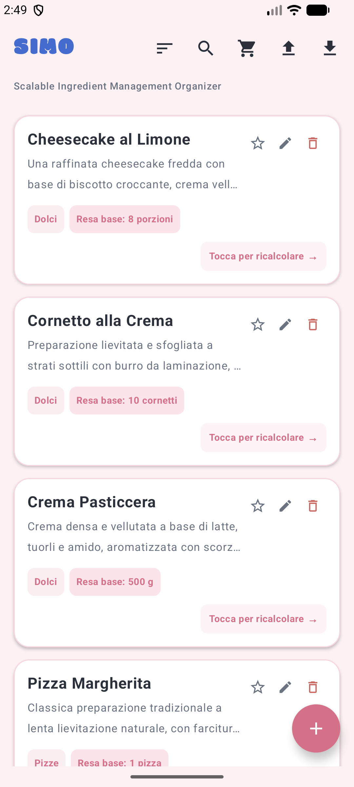
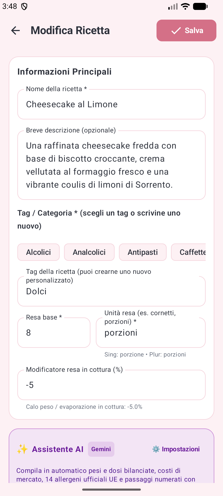
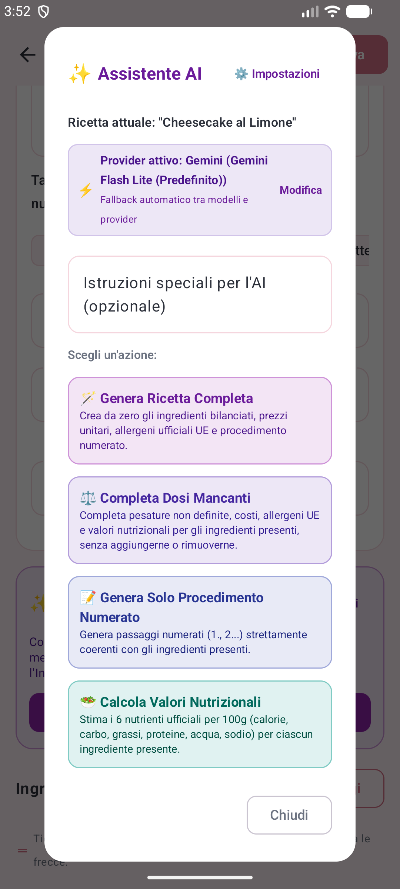
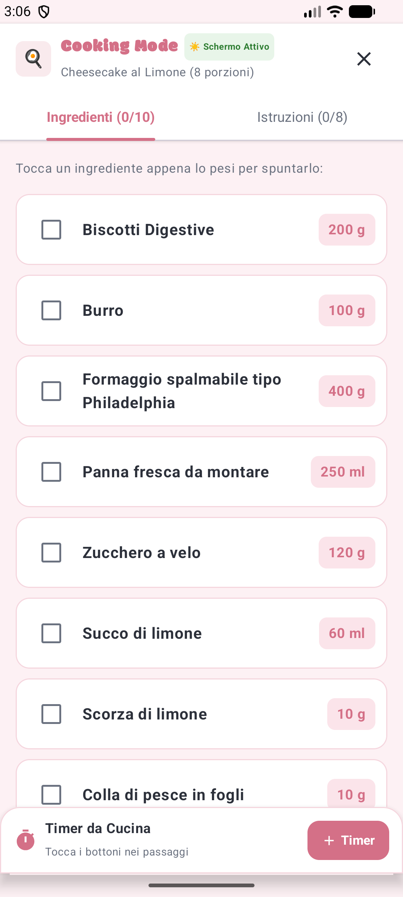
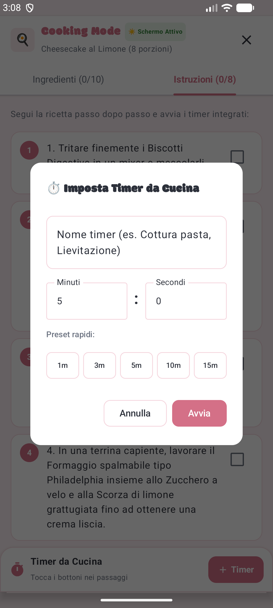

# SIMO – Manuale d'Istruzioni e Guida all'Uso

> **Scalable Ingredient Management Organizer (SIMO)**  
> *Versione 2.0 (Release Ufficiale)* – Sistema Operativo Android (API Level 26–35+)  
> Soft Macaron Palette & Bubble Typography • Dual Cloud AI (Gemini & ChatGPT)

---

## 1. Benvenuti in SIMO

**SIMO** (*Scalable Ingredient Management Organizer*) nasce per rispondere in modo scientifico, elegante ed intuitivo a un'esigenza fondamentale di chiunque operi in cucina, in pasticceria o in un laboratorio artigianale: **il calcolo proporzionale e analitico delle dosi, delle rese e dei costi**.

Spesso i ricettari tradizionali presentano formulazioni calibrate su dosi fisse (ad esempio una torta per 8 persone o un impasto per 500 g di farina), ma le reali esigenze produttive sono mutevoli: un banchetto con 45 invitati, una fornitura di 80 cornetti, oppure una dispensa in cui sono rimasti solo 130 g di burro o 2 uova. Inoltre, la moderna legislazione alimentare europea (Regolamento UE 1169/2011) impone una trasparenza rigorosa sia sugli **allergeni** sia sulla **dichiarazione nutrizionale** obbligatoria dei prodotti finiti.

### Le Caratteristiche e Innovazioni di SIMO
SIMO non è un semplice taccuino di appunti, bensì un sofisticato **motore matematico e relazionale a grafo (DAG)**:
* **Ricalcolo Dinamico Diretto (Scaling):** Modifichi la resa (es. porzioni, pezzi, grammi) e tutti gli ingredienti si aggiornano istantaneamente con precisione decimale.
* **Modificatore Peso e Resa in Cottura:** Imposti la variazione di peso subita durante la cottura (calo peso negativo per evaporazione nel forno come per torte e carni, oppure aumento di massa positivo per assorbimento d'acqua come per pasta e riso).
* **Dichiarazione Nutrizionale UE Integrata (Reg. UE 1169/2011):** Tabella nutrizionale completa con i 6 valori fondamentali (Calorie, Carboidrati, Grassi, Proteine, Acqua, Sodio e Sale equivalente calcolato), espressi sia per 100 g sia per singola porzione di prodotto finito cotto.
* **Reverse Scaling dalla Dispensa:** Inserisci la quantità dell'ingrediente limitante rimasto in magazzino e SIMO riparametra l'intera ricetta a ritroso.
* **Sotto-Ricette Gerarchiche a Cascata (DAG):** Colleghi preparazioni base (es. *Crema Pasticcera*) all'interno di ricette composte (es. *Cornetto alla Crema*). La scalatura e gli allergeni si propagano automaticamente lungo l'intero albero matematico.
* **Food Cost al Centesimo ed Equivalenza Culinaria:** Calcolo in tempo reale del costo totale dell'impasto e del costo industriale per singola porzione, con conversioni metriche automatiche ($g \leftrightarrow kg$, $ml \leftrightarrow l$) ed equivalenza culinaria massa-volume 1:1.
* **Esportazione PDF Professionale A4 (Minimo 2 Pagine):** Genera schede tecniche vettoriali di laboratorio: Pagina 1 con metadati, ingredienti, food cost, allergeni e tabella nutrizionale UE; Pagina 2 con il procedimento di preparazione ad alta visibilità in nero pieno.
* **Cooking Mode Protetta:** Schermo sempre attivo (*Keep Screen On*) e timer multipli concorrenti con estrazione automatica dei tempi dalle istruzioni.
* **Assistente Chef AI Bivalente (Gemini & ChatGPT):** Generazione completa, completamento intelligente delle dosi mancanti e stima nutrizionale non-distruttiva, con preservazione dell'unità di misura desiderata (es. *torta*, *bicchieri*, *panini*).
* **Nuova Categoria Predefinita Panini:** Categoria gastronomica dedicata per la panificazione e la paninoteca artigianale.

---

## 2. Esplorare il Ricettario e la Schermata Home

All'avvio dell'applicazione verrai accolto dalla schermata principale, disegnata secondo una palette di colori pastello morbidi (*Soft Macaron*) che garantisce un contrasto ideale sia alla luce naturale del laboratorio sia in ambienti di cottura. Grazie al motore di pre-caricamento asincrono immediato, l'intero ricettario viene popolato istantaneamente, eliminando qualsiasi schermata bianca transitoria.

### 2.1 Comprendere la Scheda di ciascuna Ricetta
Ogni elemento del ricettario mostra a colpo d'occhio i dati fondamentali:
* **Nome e Descrizione Culinaria:** Il titolo della ricetta e un breve riassunto delle sue caratteristiche organolettiche e procedurali.
* **Badge Categoria (`Dolci`, `Pizze`, `Panini`, `Primi`):** Segnala la tipologia di preparazione e permette il filtraggio tematico con un tocco.
* **Badge Resa Base:** Indica le dosi originali registrate (ad esempio *Resa base: 8 porzioni*, *10 cornetti* oppure *500 g*).
* **Icona Preferiti (Stella):** Con un semplice tocco sulla stella puoi contrassegnare o rimuovere qualsiasi ricetta dai tuoi preferiti.
* **Pulsanti Rapidi:** L'icona **Matita** apre la modifica della ricetta, il **Cestino** consente l'eliminazione sicura (con salvaguardia delle ricette correlate) e il pulsante **Vedi Ricetta** conduce direttamente alla console di dettaglio e ricalcolo.

### 2.2 Ricerca, Categorie Predefinite e Ordinamento
Nella barra superiore (*Top Bar*) trovi tutti gli strumenti per gestire il catalogo:
1. **Barra Scorrevole delle Categorie:** Include le categorie predefinite dell'applicazione (*Dolci, Pizze, Panetteria, Panini, Antipasti, Primi, Secondi, Contorni, Zuppe, Alcolici, Analcolici, Caffetteria*) oltre a eventuali tag personalizzati, ordinati alfabeticamente. Toccando un tag, il ricettario mostra solo le preparazioni corrispondenti.
2. **Icona Ordinamento ($\equiv$):** Permette di visualizzare le ricette secondo diversi criteri:
   * *Dalla A alla Z* / *Dalla Z alla A* (ordine alfabetico);
   * *Dal più recente* / *Dal meno recente* (ordine cronologico);
   * *Solo Preferiti* (mostra unicamente le preparazioni contrassegnate con la stella).
3. **Campo di Ricerca Testuale:** Digitando una parola, il catalogo filtra all'istante le ricette per corrispondenza nel titolo o negli ingredienti.

---

## 3. Creazione e Modifica delle Ricette

SIMO offre un ambiente di redazione avanzato, accessibile tramite il pulsante circolare **[+]** nella schermata principale oppure toccando la **Matita** su una ricetta esistente.

### 3.1 Dati Generali e Modificatore Peso in Cottura
Nella prima sezione della scheda è possibile impostare:
* **Nome della Ricetta:** Titolo formale della preparazione.
* **Categoria e Tag:** Selezione rapida tra i tag ufficiali (compreso *Panini*) o inserimento di una categoria personalizzata.
* **Resa Base e Unità di Resa:** La quantità di riferimento (es. *4 porzioni*, *1 torta*, *2 bicchieri*, *6 panini*).
* **Modificatore Peso in Cottura (%):** Campo fondamentale introdotto nella versione 2.0. Permette di registrare la percentuale di variazione della massa durante il trattamento termico:
  * **Valori Negativi (Calo Peso):** Es. `-10%` per torte e crostate, `-15%` per arrosti o `-8%` per creme da pasticceria che perdono acqua per evaporazione in forno o sul fornello.
  * **Valori Positivi (Resa/Aumento di Massa):** Es. `+120%` per pasta secca o riso che assorbono liquidi durante la bollitura raddoppiando o triplicando il proprio peso iniziale.
  * **Valore Neutro (0%):** Per preparazioni a crudo, cocktail o piatti freddi senza variazione ponderale.

### 3.2 Inserimento e Gestione dei 6 Valori Nutrizionali
Toccando ciascun ingrediente, si accede alla configurazione analitica dettagliata:
Oltre al nome, alla dose, al costo commerciale e ai 14 allergeni, per ogni ingrediente è possibile registrare i **6 parametri nutrizionali ufficiali per 100 g**:
1. **Calorie (kcal):** Valore energetico espresso in chilocalorie.
2. **Carboidrati (g):** Contenuto di glucidi per 100 g.
3. **Grassi (g):** Contenuto lipidico per 100 g.
4. **Proteine (g):** Quota proteica per 100 g.
5. **Acqua / Umidità Residua (g):** Grammi d'acqua presenti in 100 g di prodotto.
6. **Sodio (mg):** Milligrammi di sodio (da cui SIMO calcola automaticamente l'equivalente in sale: $\text{Sale} = \text{Sodio [g]} \times 2.5$).

### 3.3 Banner Assistente AI: Calcola Nutrizione vs Completa Dosi
Nella parte superiore dell'editor è collocato il banner dell'Assistente AI. Toccando **Apri Assistente AI** si apre la finestra di dialogo operativa:
* **Calcola Valori Nutrizionali:** Analizza gli ingredienti già presenti e calcola esclusivamente i 6 valori nutrizionali per 100 g basandosi su tabelle ufficiali (CREA / USDA). **Non modifica né cancella** le pesature, i costi unitari e gli allergeni precedentemente inseriti!
* **Completa Dosi Mancanti:** Perfeziona la ricetta bilanciando grammature, costi, allergeni e valori nutrizionali per gli ingredienti privi di dose, senza aggiungere o rimuovere ingredienti.
* **Genera Ricetta Completa:** Genera da zero l'intera ricetta (dosi, costi, allergeni, valori nutrizionali, calo peso e passaggi numerati).

---

## 4. Il Cuore di SIMO: Scaling, Cottura e Reverse Scaling

Nel dettaglio di ogni ricetta risiede il cruscotto di calcolo proporzionale in tempo reale.

### 4.1 Controller di Resa e Variazione Peso in Cottura
Il pannello **Ricalcolo Dinamico** unifica la scalatura delle porzioni con la fisica della cottura:
* I pulsanti **[–]** e **[+]** consentono di variare la resa con visualizzazione del moltiplicatore scalare (es. **1.00x**, **2.50x**).
* **Confronto Crudo vs Cotto:** Il box mostra sia il peso totale dell'impasto crudo sommato prima della lavorazione (es. *Impasto crudo: 618 g*), sia il peso del prodotto finito dopo la cottura (es. *Cotto finito: 568.56 g* con calo dell'8%).
* **Resa Cotta a Porzione:** SIMO indica il peso netto stimato di ciascuna singola porzione cotta finita (es. *~71 g a porzione*).

### 4.2 Reverse Scaling dalla Dispensa
Se disponi di una quantità limitata di una materia prima (ad esempio 120 g di burro anziché 175 g):
1. Tocca la pillola con la quantità dell'ingrediente vincolante;
2. Inserisci la quantità effettivamente disponibile e conferma;
3. L'intero albero di componenti e la resa totale si riparametreranno all'istante attorno a quel vincolo.

### 4.3 Sotto-Ricette Gerarchiche a Cascata
Nel *Cornetto alla Crema*, la preparazione richiede la *Crema Pasticcera*. SIMO la tratta come una sotto-ricetta collegata: espandendo la card è possibile visualizzare i componenti interni (latte, tuorli, amido) con le dosi ricalcolate per la quantità di crema necessaria ai cornetti.

---

## 5. Dichiarazione Nutrizionale UE, Allergeni e Food Cost

### 5.1 Scheda Nutrizionale Grafica UE (Regolamento UE 1169/2011)
In fondo alla schermata di dettaglio, sotto la lista degli ingredienti e degli allergeni, compare la nuova **Dichiarazione Nutrizionale Grafica UE**:

* **Dicitura Ufficiale di Stima:** L'intestazione riporta chiaramente la dicitura *"DICHIARAZIONE NUTRIZIONALE (Stima – Reg. UE n. 1169/2011)"*.
* **Doppia Colonna di Riferimento:** I valori medi sono suddivisi su due colonne: **Per 100 g** e **Per Porzione** (con peso esatto della porzione cotta finita).
* **Protezione Tipografica Monoriga per l'Energia:** La riga dell'energia riporta congiuntamente i valori in **kJ** e in **kcal** (es. *984 kJ / 235 kcal*) formattati per non andare mai a capo o subire troncamenti.
* **I 7 Parametri Standard UE:** Energia, Grassi, Carboidrati, Proteine, Sale equivalente (derivato dal Sodio moltiplicato per 2.5), Sodio e Acqua (umidità residua).
* **Concentrazione Nutrienti con Modificatore Cottura:** I valori per 100 g tengono conto dell'evaporazione d'acqua in cottura: se l'impasto perde il 10% d'acqua, i macronutrienti nei 100 g di prodotto finito risulteranno proporzionalmente concentrati, riflettendo la reale chimica alimentare!

### 5.2 Allergeni Normativi UE e Food Cost al Centesimo
* **14 Allergeni UE:** Evidenziati con chip colorati e badge monoriga protetti (*Allergene #N*), ereditati ricorsivamente da tutte le sotto-ricette.
* **Food Cost in Tempo Reale:** Calcola il costo totale dell'impasto e il costo a porzione/pezzo con equivalenza culinaria 1:1 per densità unitaria ($1\,\text{g} = 1\,\text{ml}$ e $1\,\text{kg} = 1\,\text{l}$), prevenendo distorsioni di prezzo quando i liquidi (es. latte, caffè, panna) vengono dosati in millilitri ma tariffati in litri o chilogrammi.

---

## 6. Cooking Mode e Timer Multipli Integrati

La **Cooking Mode** trasforma SIMO in un cruscotto operativo da banco per la preparazione attiva.

| Cooking Mode a Schermo Attivo | Regolazione Rapida Timer |
|:---:|:---:|
|  |  |

* **Schermo Sempre Attivo (*Keep Screen On*):** Nessun blackout del display mentre le mani sono sporche o bagnate.
* **Checklist di Pesatura e Passaggi:** Caselle di spunta rapide per segnare gli ingredienti pesati e le fasi procedurali completate.
* **Riconoscimento Automatico dei Timer nel Testo:** Frasi come *"infornare per 35 minuti"* o *"cuocere per 12 minuti"* generano pulsanti interattivi immediati con il conto alla rovescia preimpostato.
* **Resilienza in Background con Foreground Service:** Puoi cambiare app (es. guardare un tutorial su YouTube o rispondere al telefono): i timer continuano a scorrere e suoneranno con allarme acustico e vibrazione allo scadere.

---

## 7. Lista della Spesa Intelligente

Accessibile dal menu superiore o direttamente dal dettaglio ricetta tramite il tasto verde **Aggiungi a Spesa**:

* **Aggregazione Automatica:** Se più ricette utilizzano lo stesso ingrediente con la stessa unità, le quantità vengono unificate in una sola riga (es. $200\,\text{g} + 150\,\text{g} = 350\,\text{g}$ di burro).
* **Stima del Costo Totale della Spesa:** Calcola in tempo reale la spesa economica complessiva convertendo automaticamente i prezzi registrati al chilogrammo o al litro.
* **Gestione Articoli "q.b.":** Gli articoli a dose libera adottano un quantitativo d'acquisto standard (100 g o 1 unità) per agevolare l'approvvigionamento al supermercato.

---

## 8. Assistente Chef AI, Stampa PDF Multipagina e Backup

### 8.1 Assistente Chef AI Bivalente (Gemini & ChatGPT)
SIMO integra nativamente due motori di intelligenza artificiale: **Google Gemini** e **OpenAI ChatGPT**.

* **Preservazione Intelligente dell'Unità di Resa:** Quando imposti un'unità personalizzata (es. *torta*, *bicchieri*, *panini*, *fette*, *crostate*), l'AI valuta la coerenza culinaria con la ricetta richiesta:
  * Se l'unità è congruente (es. *torta* per una cheesecake, *bicchieri* per un cocktail o un frappè, *panini* per burger o panini), l'AI **mantiene la tua unità** e calibra le dosi su di essa!
  * Solo se l'unità è palesemente priva di senso gastronomico (es. *bicchieri* per una pizza o un risotto), l'AI torna a *porzioni*.
* **Valori Realistici e Bilanciati:** I prompt di sistema impongono il massimo rigore gastronomico, dosaggi calibrati, prezzi di mercato italiani e valori nutrizionali fedeli.
* **Sicurezza Hardware-Backed AES-256 GCM:** Le tue chiavi API di Google ed OpenAI sono crittografate nel chip hardware sicuro (*Android KeyStore*) del dispositivo e non vengono mai esportate nei backup.

### 8.2 Esportazione PDF Professionale A4 (Minimo 2 Pagine)
Dalla scheda di dettaglio, toccando l'icona **PDF**, SIMO genera un documento A4 stampabile:
* **Minimo 2 Pagine Garantito:**
  * **Pagina 1:** Intestazione SIMO, data, resa e porzioni, tabella delle materie prime scalate, box Food Cost, tabella degli allergeni UE e la dichiarazione nutrizionale UE completa;
  * **Pagina 2 (e successive):** Interamente dedicata al **Procedimento di Preparazione**, stampato con testo in nero pieno nitido ad alto contrasto per la massima leggibilità sul banco di lavoro.
* Condivisione immediata tramite WhatsApp, Telegram, email, Google Drive o stampa diretta Wi-Fi.

### 8.3 Backup e Ripristino JSON con Risoluzione Conflitti
Dalla barra principale puoi esportare l'intero archivio in un file standard `.json` (schema versione 2) contenente tutti i valori nutrizionali, i costi e i modificatori di cottura. Al momento del ripristino su un nuovo telefono, SIMO ti consentirà di risolvere individualmente ogni eventuale conflitto tra ricette nuove ed esistenti.
