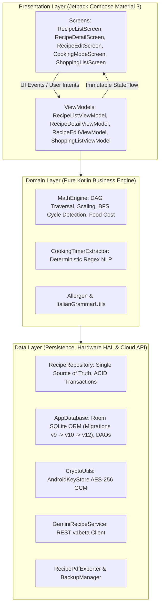

# Scalable Ingredient Management Optimizer
> **Scalable Ingredient Management Optimizer** (**SIMO**) è un'applicazione Android concepita per chef, maestri pasticceri, laboratori di panificazione artigianale e appassionati esigenti. Nasce da una richiesta di un'amico pasticcere che aveva bisogno di un'app che aveva bisogno di un ricettario con calcolo delle proporzioni tra gli ingredienti. SIMO modella il ricettario come un grafo matematico gerarchico ad albero (DAG), offrendo scalatura dinamica lineare e inversa (*reverse scaling*), calcolo analitico del food cost al centesimo, tracciabilità normativa rigorosa dei 14 allergeni alimentari (Regolamento UE 1169/2011), cooking mode a schermo sempre attivo con timer multipli concorrenti resilienti in background, lista della spesa intelligente e assistenza culinaria generativa integrata con Google Gemini AI. SIMO è stata sviluppata su Android Studio. 

## Guida Installazione
In questa sezione vengono descritti i requisiti di sistema, le modalità di installazione dei pacchetti precompilati APK su dispositivi Android e le istruzioni per la compilazione dal codice sorgente per sviluppatori.

### Requisiti di Sistema
* **Sistema Operativo:** Android 8.0 (Oreo, API Level 26) o versioni successive (pienamente testato e compatibile fino ad Android 15 / API Level 35+).
* **Architettura Dispositivo:** Supporto per architetture ARM64 (aarch64), ARMv7 (armeabi-v7a) e x86_64.
* **Memoria RAM:** Minimo 2 GB (consigliati 3 GB o superiori per un rendering fluido a 60 FPS di alberi di ricette complessi).
* **Spazio su Disco:** Circa 25-35 MB per l'installazione dell'applicazione e archiviazione del database locale SQLite (Room).

### Installazione Diretta tramite APK
L'applicazione viene distribuita direttamente tramite file APK firmati, consentendo l'installazione autonoma senza passare dal Google Play Store:

1. **Scaricare il pacchetto APK:**
   * Trasferire o scaricare sul dispositivo Android il file `SIMO-release.apk` (o `SIMO.apk`).
2. **Abilitare l'installazione da origini sconosciute:**
   * Sui dispositivi Android moderni (Android 8.0 e successivi), toccando il file APK scaricato tramite il browser (es. Chrome) o il file manager di sistema verrà mostrato un avviso di sicurezza.
   * Selezionare **Impostazioni** sul popup e abilitare la spunta **Consenti da questa origine** per autorizzare il browser o il gestore file a installare pacchetti esterni.
3. **Completare l'installazione:**
   * Tornare alla schermata precedente e premere **Installa**.
   * Al termine, toccare **Apri** per avviare immediatamente SIMO.

> [!NOTE]
> **Avviso Google Play Protect:**  
> L'APK di rilascio è firmato crittograficamente con il Keystore personale dello sviluppatore (RSA 2048-bit, con schemi di firma v1, v2 e v3, emesso a nome di *Francesco Panattoni, SIMO*). Trattandosi di un'installazione autonoma non scaricata dai server Google Play, la scansione di protezione Play Protect potrebbe mostrare una schermata informativa con scritto *"App di sviluppatore sconosciuto"*. È sufficiente toccare **Ulteriori dettagli** e confermare con **Installa comunque**.

### Differenza tra SIMO-release.apk e SIMO-debug.apk
All'interno della cartella di distribuzione sono disponibili due varianti del pacchetto:

| Proprietà | `SIMO-release.apk` (Consigliato per l'Uso Quotidiano) | `SIMO-debug.apk` (Sviluppo e Debugging) |
| : | : | : |
| **Ottimizzazione R8/ProGuard** | **Abilitata:** Codice ottimizzato, minificato, dead-code rimosso e desugaring Java 8+ attivo. | **Disabilitata:** Codice non compresso, conserva i simboli di debug completi. |
| **Prestazioni di Esecuzione** | Massima velocità di calcolo matematico, rendering Compose nativo fluido a 60 FPS. | Minore fluidità dovuta ai controlli e al tracciamento di debug a runtime. |
| **Dimensione Pacchetto** | Circa **8 - 12 MB** (snello ed efficiente). | Circa **25 - 35 MB** (più voluminoso). |
| **Firma Digitale** | Keystore ufficiale di produzione con chiave crittografica RSA-2048. | Chiave standard `androiddebugkey` generata dal toolchain Gradle. |
| **Destinazione** | Dispositivo personale dello chef, postazioni di lavoro, produzione. | Test su emulatore, diagnostica Logcat, ispezione del database con Android Studio. |

### Compilazione dal Codice Sorgente (Per Sviluppatori)
Se si desidera compilare il progetto partendo dai sorgenti Kotlin:

1. **Prerequisiti Software:**
   * **Git** installato.
   * **JDK 17** o superiore (es. OpenJDK 17, Eclipse Temurin 17).
   * **Android Studio** (Koala, Ladybug o versioni più recenti) con Android SDK Platforms 24-35 installati.
2. **Clonazione della Repository:**
   ```bash
   git clone https://github.com/tuo-username/SIMO.git
   cd SIMO
   ```
3. **Compilazione via Riga di Comando:**
   * **Su Windows (PowerShell / Prompt dei Comandi):**
     ```powershell
     # Compilazione pacchetto Release
     .\gradlew.bat assembleRelease

     # Compilazione pacchetto Debug
     .\gradlew.bat assembleDebug
     ```
   * **Su Linux / macOS:**
     ```bash
     chmod +x gradlew
     ./gradlew assembleRelease
     ```
4. **Locazione dei file APK compilati:**
   * Release APK: `app/build/outputs/apk/release/app-release.apk`
   * Debug APK: `app/build/outputs/apk/debug/app-debug.apk`


## Manuale d'Istruzioni e Guida all'Uso
### Benvenuti in SIMO
La gestione delle ricette professionali, sia nell'alta pasticceria che nella ristorazione o nella panificazione artigianale, presenta complessità che vanno ben oltre un semplice taccuino di appunti. Una ricetta moderna non è quasi mai una lista piatta di soli ingredienti grezzi: spesso è una composizione gerarchica di preparazioni di base (chiamate **sotto-ricette**), ciascuna con i propri tempi, rese, costi e allergeni.

**SIMO** nasce per risolvere in modo scientifico ed elegante queste sfide. I pilastri operativi dell'applicazione comprendono:
* **Ricette Composte e Albero Gerarchico:** Possibilità di utilizzare una ricetta completa (es. *Crema Pasticcera Classica*) come ingrediente all'interno di una o più preparazioni complesse (es. *Cornetto alla Crema*). Qualsiasi modifica alla ricetta di base si propaga automaticamente e in tempo reale a tutte le preparazioni derivate.
* **Scaling Lineare e Reverse Scaling:** Oltre a moltiplicare le dosi per ottenere un certo numero di porzioni o chilogrammi, SIMO offre l'esclusivo **Reverse Scaling**: indicando quanti grammi di un ingrediente chiave si hanno in dispensa (ad esempio, 120 g di burro rimasti invece dei 175 g previsti), l'intera ricetta e tutte le sue componenti vengono riparametrate all'istante attorno a quel vincolo.
* **Food Cost al Centesimo:** Attribuendo un prezzo di acquisto e un'unità commerciale a ciascun ingrediente (es. 1.80 €/kg), SIMO calcola in tempo reale il costo totale dell'impasto e il costo industriale di ogni singola porzione, con conversioni metriche automatiche ($g \leftrightarrow kg$, $ml \leftrightarrow l$).
* **Tracciabilità degli Allergeni (Regolamento UE 1169/2011):** Mappatura rigorosa dei 14 allergeni normativi. Se una sotto-ricetta contiene uova o latte, tali allergeni risalgono automaticamente l'albero gerarchico fino al prodotto finito.
* **Cooking Mode a Schermo Attivo:** Una modalità dedicata alla cucina che mantiene il display sempre acceso (*Keep Screen On*), fornisce una lista di spunta rapida per la pesata degli ingredienti, una guida passo-passo alle istruzioni e timer multipli concorrenti con avvisi acustici e vibrazione.
* **Assistente Chef AI:** Integrazione con l'intelligenza artificiale Google Gemini per ideare, creare e bilanciare ricette professionali direttamente nell'app con un solo tocco.

### Esplorare il Ricettario e la Schermata Home
All'avvio di SIMO si accede alla schermata principale del ricettario, progettata per offrire un controllo visivo immediato su tutto il catalogo delle preparazioni.


#### Struttura della Scheda Ricetta
Ogni ricetta nell'elenco è racchiusa in una scheda interattiva ad alto contrasto che evidenzia:
* **Nome della Ricetta e Categoria:** Indicazione del titolo e del genere gastronomico di appartenenza.
* **Resa Base (Base Yield):** La resa standard della preparazione (es. 10 cornetti, 4 porzioni, 800 g di crema).
* **Badge degli Allergeni:** Icone ed etichette che segnalano a colpo d'occhio la presenza di sostanze soggette a dichiarazione obbligatoria.
* **Icona Stella dei Preferiti:** Permette di contrassegnare rapidamente con un tocco le preparazioni utilizzate più di frequente per ritrovarle istantaneamente.

#### Categorie e Tag Tematici
Sotto la barra di navigazione superiore è posizionata una riga orizzontale a scorrimento con i **Tag Categoria** (es. *Tutte, Dolci, Primi, Secondi, Pizze, Lievitati, Base*). Toccando un tag, il ricettario mostra esclusivamente le ricette appartenenti a quella categoria.

> [!NOTE]
> Il sistema gestisce le categorie in modo dinamico: un tag esiste e rimane visibile nel filtro rapido solo se è presente almeno una ricetta associata ad esso. Se una categoria viene modificata o se l'unica ricetta ad essa associata viene eliminata, il tag corrispondente scompare automaticamente dalla barra per mantenere l'interfaccia pulita.

#### Barra di Ricerca e Filtri Rapidi
In alto è sempre disponibile la barra con dicitura **"Cerca ricetta..."**. Digitando una o più lettere, l'elenco si aggiorna istantaneamente filtrando le ricette per corrispondenza nel titolo. Quando un filtro è attivo, un pulsante laterale **"Azzera"** con l'indicatore numerico delle ricette trovate consente di resettare la ricerca con un singolo tocco.

#### Menu di Ordinamento e Disposizione
Toccando l'icona delle opzioni di ordinamento in alto a destra, si apre un menu dedicato che permette di riordinare il catalogo secondo diversi criteri:
* **Nome (A-Z)** o **Nome (Z-A)**;
* **Più recenti** (in base alla data di creazione) o **Meno recenti**;
* **Solo Preferiti:** Mostra unicamente le ricette contrassegnate dalla stella.


### Creazione e Modifica delle Ricette
Premendo il pulsante circolare galleggiante con l'icona `+` (*Floating Action Button*) nella schermata principale, si accede all'ambiente di redazione della ricetta.

#### Dati Generali della Preparazione
Nella parte superiore della scheda di modifica è possibile impostare:
1. **Nome della Ricetta:** Il titolo identificativo (es. *Risotto ai Funghi Porcini*).
2. **Categoria:** Selezionabile tra quelle suggerite o inseribile come nuovo valore personalizzato.
3. **Resa Base e Unità di Resa:** La quantità prodotta dalla ricetta di riferimento (es. quantità `4`, unità `porzioni`; oppure quantità `500`, unità `g`).
4. **Descrizione:** Breve nota descrittiva o introduzione alla preparazione.
5. **Istruzioni di Preparazione:** Il testo dettagliato della procedura culinaria. È possibile scrivere i passaggi numerati (1, 2, 3...) specificando i tempi di cottura o di riposo (es. *"Cuocere per 25 minuti a fuoco medio"*): il motore intelligente di SIMO li riconoscerà automaticamente per generare i timer interattivi.

#### Inserimento di Ingredienti e Sotto-Ricette
Per arricchire la composizione, premere **"Aggiungi Ingrediente"**. Si aprirà il selettore che consente di:
* Scegliere una **materia prima base** già registrata nel magazzino (es. *Farina 00, Zucchero semolato, Burro*);
* Selezionare un'altra **ricetta esistente** da inserire come sotto-ricetta (es. aggiungere la *Crema Pasticcera* dentro l'impasto del *Cornetto*);
* Creare al volo un **nuovo ingrediente non ancora presente** in archivio, specificando nome, unità predefinita, costo e allergeni.

#### Modifica Dettagliata di Nomi, Costi e Allergeni
Ogni ingrediente inserito nell'elenco dispone di un pulsante di modifica dettagliata. Toccandolo è possibile personalizzare:
* Il nome merceologico dell'ingrediente;
* Il prezzo unitario di acquisto e la relativa unità commerciale (es. 1.20 € al kg, oppure 0.30 € al pezzo);
* L'elenco degli allergeni tra i 14 previsti dalla normativa europea.

> [!TIP]
> Qualsiasi modifica apportata al costo unitario o agli allergeni di un ingrediente durante la composizione viene sincronizzata in modo persistente nel database generale dell'app, aggiornando automaticamente anche le altre ricette che condividono quella materia prima.

#### Riordinamento degli Ingredienti (Drag & Drop e Frecce)
L'ordine degli ingredienti nella lista può essere modificato a piacimento:
* **Frecce Su/Giù:** Per spostamenti discreti di una singola posizione;
* **Trascina e Rilascia (Drag & Drop fluido):** Tenendo premuta l'icona di trascinamento a destra di un ingrediente, l'elemento si solleva visivamente con un'animazione dedicata e può essere trascinato verso l'alto o verso il basso su qualsiasi numero di posizioni senza mai sollevare il dito.

#### Avviso Dosi Mancanti e Completamento con AI
Se durante la compilazione manuale o l'importazione da testo alcuni ingredienti vengono inseriti senza quantità (oppure con dose pari a 0), SIMO evidenzia la riga con un chiaro segnale di attenzione. In basso apparirà il pulsante **"Completa Dosi Mancanti con AI"**: premendolo, l'assistente chef analizzerà la ricetta, il tipo di preparazione e la resa desiderata, calcolando e suggerendo le dosi proporzionate corrette per gli ingredienti incompleti.

### Il Cuore di SIMO: Scaling e Reverse Scaling
La schermata di dettaglio di una ricetta è il centro operativo in cui si manifesta la potenza analitica di SIMO.


#### Il Controller di Resa (Scaling Lineare)
In cima alla schermata è presente il controller interattivo della quantità di resa. È possibile modificare la resa desiderata in tre modi:
1. Premendo i pulsanti rapidi **`-`** e **`+`**;
2. Toccando direttamente il numero per digitare una qualsiasi cifra personalizzata (es. passare da 10 a 35 cornetti, oppure da 4 a 12 porzioni);
3. Premendo il pulsante **"Ripristina Resa Base"** per tornare istantaneamente ai parametri originali.

Tutti gli ingredienti della lista, i relativi costi e i pesi delle eventuali sotto-ricette si ricalcolano istantaneamente senza alcun rallentamento visivo.

#### Reverse Scaling: Scalatura a Partire dalla Dispensa
Quante volte capita di avere in dispensa solo una confezione aperta con 130 g di mascarpone o 2 uova rimaste, mentre la ricetta ne richiederebbe 250 g? Con SIMO non occorre effettuare calcoli a mano:
1. Nell'elenco degli ingredienti della ricetta, toccare la riga dell'ingrediente limitante;
2. Si aprirà la finestra di **Reverse Scaling**;
3. Inserire la quantità effettivamente disponibile (es. `130` g);
4. Premere **"Applica Scala Inversa"**.

SIMO calcolerà all'istante il fattore proporzionale esatto: la resa totale della ricetta verrà riparametrata (es. da 8 a 4.16 porzioni) e tutti gli altri ingredienti dell'impasto verranno ridotti proporzionalmente per mantenere l'equilibrio gustativo e chimico perfetto della preparazione.

#### Gestione Trasparente delle Sotto-Ricette a Cascata
Quando una ricetta contiene una o più sotto-ricette:
* La sotto-ricetta viene mostrata come un blocco evidenziato ed espandibile.
* Toccando il blocco è possibile aprire l'albero interno ed esaminare le dosi dei singoli componenti di base necessari per soddisfare la quantità richiesta.
* Il moltiplicatore di scala si propaga in cascata lungo l'intero albero matematico: se si raddoppia la produzione di *Cornetti alla Crema*, la dose richiesta di *Crema Pasticcera* raddoppierà, e a sua volta le dosi di tuorli, latte e amido all'interno della crema raddoppieranno di conseguenza.

### Food Cost e Gestione Normativa Allergeni
#### Calcolo Analitico del Food Cost
Nella scheda riassuntiva del dettaglio ricetta, SIMO calcola in tempo reale due grandezze fondamentali per la sostenibilità economica dell'attività:
* **Costo Totale dell'Impasto / Lotto:** La somma economica di tutte le materie prime necessarie per la preparazione scalata.
* **Costo per Singola Porzione / Pezzo:** Il costo totale diviso per il numero di unità o porzioni prodotte.

Il motore di calcolo esegue conversioni metriche automatiche: se il prezzo della farina è memorizzato in €/kg (es. 1.60 €/kg) e la ricetta scalata richiede 350 g, il costo attribuito sarà esattamente pari a:
$$\text{Costo} = 350 \times 10^{-3} \times 1.60 = 0.56\text{ €}$$

> [!NOTE]
> **Gestione degli ingredienti "q.b." (quanto basta):**  
> Gli ingredienti qualificati come *q.b.* (come un pizzico di sale fino o spezie aromatiche) non hanno un peso ponderale misurabile a priori e non alterano artificiosamente il conteggio economico del lotto, venendo contabilizzati con incidenza zero sul calcolo automatico.

#### Tabella dei 14 Allergeni Normativi (Regolamento UE 1169/2011)
SIMO mappa e traccia nativamente l'elenco completo dei 14 allergeni alimentari normati a livello europeo:

| N° | Allergene | Esempi Tipici di Materie Prime Coinvolte |
| :: | : | : |
| **1** | **Glutine** | Frumento, farina di grano tenero e duro, segale, orzo, avena, farro, manitoba |
| **2** | **Crostacei** | Gamberi, scampi, aragoste, granchi |
| **3** | **Uova** | Uova intere, tuorli, albumi, maionese artigianale |
| **4** | **Pesce** | Prodotti ittici, colatura d'alici, salse a base di pesce |
| **5** | **Arachidi** | Arachidi tostate, burro d'arachidi, oli di arachide grezzi |
| **6** | **Soia** | Farina di soia, latte di soia, lecitina di soia, tofu |
| **7** | **Latte** | Latte intero e parzialmente scremato, burro, panna fresca, formaggi, mascarpone |
| **8** | **Frutta a guscio** | Mandorle, nocciole, noci, pistacchi, anacardi |
| **9** | **Sedano** | Sedano da costa, sedano rapa, fondi e brodi vegetali |
| **10** | **Senape** | Semi di senape, salse e mostarde |
| **11** | **Semi di sesamo** | Semi di sesamo per guarnizione pani, olio di sesamo |
| **12** | **Anidride solforosa e solfiti** | Vini da sfumare, frutta disidratata con conservanti ($> 10\,\text{mg/kg}$) |
| **13** | **Lupini** | Farine a base di lupino, preparati vegani |
| **14** | **Molluschi** | Cozze, vongole, calamari, polpo, seppie |

#### Presentazione Grafica Anti-Frammentazione dei Badge
Nella scheda degli allergeni, ogni voce è identificata dal nome della categoria merceologica e da un badge normativo (es. `Allergene #7`). L'interfaccia di SIMO adotta un algoritmo tipografico protetto da vincoli di linea singola (*soft-wrap prevention*): anche in presenza di nomi lunghi o caratteri di grandi dimensioni sul display dello smartphone, il badge numerico non subisce mai compressione o spezzature antiestetiche, restando sempre chiaro e leggibile.

### Cooking Mode e Timer Multipli Integrati
Premendo il pulsante **"Avvia Modalità Cucina"** nel dettaglio di una ricetta, l'interfaccia si trasforma in un cruscotto operativo appositamente studiato per l'ambiente operativo della cucina e del laboratorio.


#### Schermo Sempre Attivo (Keep Screen On)
Durante la permanenza nella modalità cucina, il display dello smartphone o del tablet rimane costantemente acceso, evitando fastidiosi spegnimenti per timeout mentre le mani sono bagnate o infarinate. Non appena si esce dalla modalità, il timeout normale del dispositivo viene ripristinato istantaneamente per preservare la batteria.

#### Checklist Pesa Ingredienti e Avanzamento Passaggi
La parte superiore della schermata presenta due sezioni con caselle di spunta rapide:
* **Lista Ingredienti da Pesare:** Mostra tutte le dosi già scalate. Toccando un ingrediente, questo viene barrato per tenere traccia di ciò che è già stato dosato nella ciotola.
* **Passaggi della Procedura:** Ciascun punto della preparazione può essere spuntato man mano che viene eseguito, offrendo una visione chiara dell'avanzamento.

#### Riconoscimento Intelligente dei Timer nel Testo
Il motore linguistico di SIMO esamina automaticamente il testo di ciascun passaggio: quando rileva indicazioni di tempo come *"impastare per 12 minuti"*, *"infornare per 45 minuti"* o *"far riposare 2 ore"*, crea all'istante un pulsante interattivo dedicato con il tempo già preimpostato. Un singolo tocco è sufficiente per avviare il timer.


#### Barra dei Timer Multipli e Finestra di Regolazione Rapida
Tutti i timer avviati confluiscono in una barra galleggiante posizionata nella parte inferiore dello schermo. La barra supporta molteplici timer contemporanei (es. un timer per la lievitazione e uno per la cottura in forno), ciascuno con la propria etichetta, barra di avanzamento circolare e pulsanti di pausa, riavvio ed eliminazione.

Toccando un timer attivo, si apre la finestra di **Regolazione Rapida** che permette con un solo tocco di aggiungere incrementi di tempo standard senza dover digitare cifre:
* **+30s** (trenta secondi extra)
* **+1m** (un minuto extra)
* **+5m** (cinque minuti extra)
* **+10m** (dieci minuti extra)


#### Resilienza in Background e Notifiche di Sistema
Se durante la cottura si riceve una telefonata, si apre YouTube per guardare un video o si blocca lo schermo del telefono:
* I timer non si interrompono: continuano a scorrere calcolando la scadenza su timestamp assoluti di sistema.
* Un servizio di primo piano (*Foreground Service*) mantiene attivo il controllo con una notifica permanente nella tendina di Android.
* Al raggiungimento dello zero, SIMO attiva un potente allarme acustico combinato con vibrazione ad impulsi continui, garantendo di non dimenticare mai una preparazione sul fuoco.

### Lista della Spesa Intelligente e Conversione Prezzi
Dalla scheda di qualsiasi ricetta (o dal menu principale), è possibile inviare gli ingredienti direttamente alla **Lista della Spesa**.


#### Aggiunta Massiva da Ricetta
Premendo il pulsante del carrello nel dettaglio ricetta, tutte le dosi attualmente scalate vengono trasferite con un solo tocco alla lista della spesa.

#### Aggregazione Automatica di Unità Uguali
Se nella lista della spesa viene inserita una nuova ricetta che richiede materie prime già presenti nell'elenco (ad esempio, 200 g di burro per la sfoglia e 80 g di burro per la glassa), SIMO riconosce la corrispondenza merceologica e unifica le voci sommando automaticamente le quantità (280 g di burro in totale), evitando inutili duplicati.

#### Conversione Metrica e Stima del Costo Totale
La lista della spesa calcola in automatico la stima della spesa economica totale:
* Se un articolo è espresso in grammi (es. 500 g) e il prezzo d'acquisto è registrato al chilogrammo (es. 2.00 €/kg), il carrello effettua la conversione metrica restituendo 1.00 € di spesa stimata per quella voce.
* Per gli ingredienti inseriti con dose *q.b.* (quanto basta), SIMO assegna per default un formato commerciale minimo (100 g per prodotti ponderali o 1 pezzo per formati discreti), consentendo all'utente di avere un riferimento chiaro per l'approvvigionamento.

### Assistente Chef AI, Stampa PDF e Backup
#### Assistente Chef Google Gemini
Premendo l'icona della bacchetta magica in cima alla lista delle ricette, si apre la finestra di dialogo dell'**Assistente Chef AI**, potenziato dai modelli generativi multimodali di Google.


È sufficiente digitare una richiesta descrittiva in linguaggio naturale, ad esempio:
> *"Creami una ricetta per una Torta Caprese al limone e mandorle per 8 persone, ben bilanciata e indicando chiaramente i tempi di cottura."*

Oppure:
> *"Ho a disposizione 400g di farina di riso, 3 uova e dello yogurt: suggeriscimi un dolce soffice senza glutine."*

SIMO contatterà l'intelligenza artificiale mostrando un indicatore lineare di progresso vettoriale. In pochi secondi la ricetta completa (titolo, categoria, resa, istruzioni con tempi e lista degli ingredienti con quantità ed allergeni) apparirà compilata e pronta per essere salvata con un tocco nel ricettario.

#### Selezione del Modello (Flash-Lite vs Flash)
Nelle opzioni dell'assistente è possibile scegliere tra due modelli:
* **Gemini Flash Lite (Consigliato):** Estremamente veloce (tempo di risposta di circa 1 secondo), perfetto per generare ricette della tradizione, salse, dolci classici e piatti veloci.
* **Gemini Flash:** Modello a maggiore profondità di calcolo e ragionamento chimico-fisico, ideale per grandi lievitati complessi (panettoni, colombe, pandori), bilanciamento zuccheri/grassi nei gelati artigianali e impasti ad altissima idratazione.

#### Sicurezza delle Credenziali API (AndroidKeyStore Hardware)
Per utilizzare l'assistente Gemini è sufficiente inserire la propria chiave API personale (ottenibile gratuitamente su Google AI Studio). SIMO protegge questa informazione mediante il coprocessore di sicurezza hardware del dispositivo (*AndroidKeyStore*): la chiave viene cifrata tramite algoritmo **AES-256 in modalità GCM**, rendendo tecnicamente impossibile qualsiasi estrazione o intercettazione esterna.

#### Esportazione e Condivisione Documenti in Formato PDF A4
Dalla schermata di dettaglio di ogni ricetta è possibile generare una scheda professionale in formato **PDF A4** stampabile, ideale per l'affissione in laboratorio o l'archiviazione cartacea. Il documento include:
* Intestazione con titolo, categoria, resa scalata e data di elaborazione;
* Tabella sinottica degli ingredienti con dosi scalate e unità di misura;
* Prospetto completo dei 14 allergeni normativi con evidenziazione di quelli presenti;
* Valutazione economica del Food Cost (totale e a porzione);
* Testo delle istruzioni formattato con word-wrapping automatico per la massima leggibilità.

Il file PDF generato può essere stampato direttamente o condiviso tramite WhatsApp, Telegram, email e Drive mediante il sistema nativo di Android.

#### Backup e Ripristino JSON con Risoluzione dei Conflitti
Dal menu impostazioni è possibile esportare in qualsiasi momento l'intero database in un unico file standard `simo_backup_*.json`.

In fase di importazione su un nuovo telefono o dopo un ripristino, il motore di ripristino esegue un'analisi preventiva a due fasi:
* Se il backup contiene ricette nuove, vengono aggiunte istantaneamente;
* Se rileva una ricetta con lo stesso nome o ID già presente nel database, SIMO chiede all'utente se desidera **Sostituire** la versione locale con quella del backup oppure **Mantenere** la copia presente, garantendo la totale sicurezza e integrità dei dati culinari.


## Manuale Tecnico
### Introduzione
#### Problem Statement & Contesto di Dominio
Nei moderni processi di preparazione culinaria professionale e di alta pasticceria, la gestione delle ricette presenta una complessità computazionale e strutturale che eccede ampiamente le capacità di un semplice archivio testuale o tabellare:
1. **Gerarchie Multi-Livello (Composite Recipes):** Le preparazioni complesse non sono insiemi piatti di materie prime, bensì aggregati di preparazioni intermedie (*sotto-ricette*). Ad esempio, un *Cornetto alla Crema* include una pasta sfogliata lievitata e una *Crema Pasticcera*. Qualsiasi variazione della resa o della ricetta base della crema deve propagarsi in modo deterministico e reattivo all'intero albero di composizione.
2. **Inversione di Scala da Vincolo di Dispensa (Reverse Scaling):** In ambiente di laboratorio o domestico, la resa finale è frequentemente vincolata dalla disponibilità residua di un ingrediente critico (es. 120 g di burro anziché 175 g). Il sistema deve calcolare il fattore di scala inverso $k \in \mathbb{R}^+$ rispetto a un generico nodo dell'albero ed estendere la proporzione all'intero grafo.
3. **Tracciabilità Normativa degli Allergeni (Regolamento UE 1169/2011):** L'obbligo di legge impone l'individuazione e la segnalazione dei 14 allergeni normativi. La presenza di un allergene in una foglia del grafo deve essere propagata ricorsivamente fino alla radice.
4. **Food Cost Contabile in Tempo Reale:** Necessità di quantificare all'istante l'incidenza economica di ciascun lotto di produzione e il costo industriale di ogni singola porzione, considerando conversioni tra unità di massa ($g, kg$), di volume ($ml, l$) e unità discrete ($pezzi, unità$).
5. **Operatività Senza Soluzione di Continuità (Cooking Mode):** Esigenza di un'interfaccia esecutiva durante la cottura che mantenga il display costantemente attivo, gestisca timer asincroni multipli con allarmi acustici e vibrazione, e supporti aggiunte rapide di tempo non intrusive.
6. **Privacy e Sicurezza delle Chiavi API di Terze Parti:** Protezione crittografica hardware-backed contro attacchi di estrazione locale o perdite accidentali nei backup per le chiavi di accesso a modelli generativi remoti (Google Gemini).

#### Requisiti Non Funzionali e Vincoli Architetturali
* **Offline-First:** Tutte le funzioni analitiche, di scaling, di navigazione del grafo, di food cost e di cottura guidata devono operare a latenza zero anche in assenza totale di connettività di rete.
* **Tempo di Calcolo dello Scaling:** Complessità temporale $O(|V| + |E|)$ rispetto al grafo di composizione, con tempo di re-rendering $\le 16\text{ ms}$ a 60 FPS per evitare frame-drop nell'interfaccia utente dichiarativa.
* **Assenza di Dipendenze Circolari:** Garanzia formale che il grafo delle ricette rimanga in ogni istante un **Grafo Diretto Aciclico** (**DAG**).
* **Memory Footprint Controllato:** Nessuna allocazione ridondante di bitmap durante l'esportazione PDF o la gestione dei timer; rilascio immediato delle risorse audio dell'Hardware Abstraction Layer (HAL).

### Architettura del Software e Pattern Architetturali
SIMO adotta una combinazione rigorosa di **Clean Architecture** e **Model-View-ViewModel** (**MVVM**), orchestrata mediante il pattern **Unidirectional Data Flow** (**UDF**) nativo di Jetpack Compose.



#### Unidirectional Data Flow (UDF) e State Immutability
Ogni schermata applicativa è funzione pura dello stato corrente (*State-Driven UI*):
$$\text{UI} = f(\text{UiState})$$
I ViewModel non espongono variabili mutabili pubbliche: ogni transizione di stato avviene tramite istanze di data class immutabili incapsulate in `StateFlow<T>`.

```kotlin
val uiState: StateFlow<RecipeListUiState> = combine(
    repository.allRecipes,
    _filterState
) { recipes, filter ->
    // Calcolo filtri, ordinamento e ricerca su pool di background
    val sortedAvailableTags = RecipeTags.getAllSortedTags(recipes.map { it.category })
    val byTags = if (filter.selectedTags.isEmpty()) recipes 
                 else recipes.filter { r -> filter.selectedTags.any { it.equals(r.category, true) } }
    val byFavorites = if (filter.favoritesOnly) byTags.filter { it.isFavorite } else byTags
    val filtered = if (filter.query.isBlank()) byFavorites 
                   else byFavorites.filter { it.name.contains(filter.query, true) }
    
    val sorted = when (filter.sort) {
        RecipeSortOption.NAME_ASC -> filtered.sortedWith(compareBy(String.CASE_INSENSITIVE_ORDER) { it.name })
        RecipeSortOption.NAME_DESC -> filtered.sortedWith(compareByDescending(String.CASE_INSENSITIVE_ORDER) { it.name })
        RecipeSortOption.DATE_DESC -> filtered.sortedByDescending { it.createdAt }
        RecipeSortOption.DATE_ASC -> filtered.sortedBy { it.createdAt }
    }
    RecipeListUiState(recipes = sorted, availableTags = sortedAvailableTags, ...)
}.flowOn(Dispatchers.Default)
 .stateIn(viewModelScope, SharingStarted.WhileSubscribed(5000), RecipeListUiState())
```

#### Concorrenza e Thread Safety
L'applicazione fa uso sistematico delle Kotlin Coroutines, assegnando rigorosamente i contesti di esecuzione:
* **`Dispatchers.Main`:** Riservato esclusivamente al rendering dichiarativo di Jetpack Compose e al binding degli eventi UI;
* **`Dispatchers.Default`:** Dedicato al calcolo analitico intensivo (espansione del DAG, determinazione dei percorsi, ordinamento, estrazione regex dei timer e ricalcolo proporzionale);
* **`Dispatchers.IO`:** Adibito all'I/O su database Room SQLite, operazioni di crittografia hardware, chiamate REST HTTP di Gemini e stream di scrittura PDF/JSON.

#### Lifecycle Optimization: Warm-up Asincrono e Pre-caching all'Avvio
Per prevenire l'anti-pattern del *Flash of Empty State* (in cui la schermata home mostra un layout vuoto per alcune centinaia di millisecondi durante l'interrogazione asincrona iniziale del database), l'architettura implementa una fase di warm-up reattivo. Durante lo splash iniziale di avvio, il repository esegue il pre-caricamento immediato della collezione completa delle entità `RecipeWithComponents`. L'emissione iniziale del relativo `StateFlow` avviene in modo concorrente con la composizione della UI, garantendo che al passaggio alla schermata del ricettario l'elenco sia già interamente popolato e ordinato.

### Domain Engine: Teoria dei Grafi e Calcolo Matematico
Il nucleo algoritmico risiede nel file `MathEngine.kt`, implementato come modulo Kotlin puro privo di dipendenze verso il framework Android.

#### Formalizzazione del Ricettario come DAG Pesato
Sia $G = (V, E, W)$ un grafo orientato pesato finito dove:
* $V = V_{\text{raw}} \cup V_{\text{recipe}}$ è l'insieme dei vertici, partizionato in materie prime $V_{\text{raw}}$ e preparazioni composte $V_{\text{recipe}}$.
* $E \subseteq V_{\text{recipe}} \times V$ è l'insieme degli archi orientati $(u, v)$, indicante che la ricetta $u$ richiede l'ingrediente o sotto-ricetta $v$.
* $W: E \to \mathbb{R}^+ \times \mathcal{U}$ è la funzione peso che associa ad ogni arco la tupla $(q, u)$ rappresentante la quantità base $q$ e l'unità di misura $u \in \mathcal{U}$.

Affinché il calcolo delle dosi converga in tempo finito e non generi paradossi fisici, $G$ deve soddisfare il vincolo fondamentale di aciclicità:
$$\forall v \in V, \quad \nexists \text{ cammino orientato } v \rightsquigarrow v \quad \iff \quad G \text{ è un DAG}$$

#### Algoritmo di Rilevamento Cicli Preventivo (`wouldCreateCycle`)
Prima di consentire l'inserimento o la modifica di un arco $(u, v)$ dove $u$ è la ricetta genitore e $v$ è la ricetta figlia candidata, il sistema valuta se esiste un cammino diretto $v \rightsquigarrow u$.

> [!IMPORTANT]
> **Teorema di Aciclicità su Inserimento di Arco:**  
> Dato un DAG $G = (V, E)$ e un arco candidato $(u, v)$, il nuovo grafo $G' = (V, E \cup \{(u, v)\})$ è un DAG se e solo se $u$ non è raggiungibile da $v$ in $G$.

L'implementazione in `MathEngine.kt` impiega una Breadth-First Search (BFS) ottimizzata:

```kotlin
fun wouldCreateCycle(
    parentRecipeId: String,
    candidateChildId: String,
    existingEdges: List<Pair<String, String>>
): Boolean {
    if (parentRecipeId.isBlank() || candidateChildId.isBlank()) return false
    if (parentRecipeId == candidateChildId) return true // Auto-loop immediato

    // Costruzione lista di adiacenza
    val adjacency = mutableMapOf<String, MutableList<String>>()
    for ((parent, child) in existingEdges) {
        if (parent.isNotBlank() && child.isNotBlank()) {
            adjacency.getOrPut(parent) { mutableListOf() }.add(child)
        }
    }

    val queue = ArrayDeque<String>()
    queue.add(candidateChildId)
    val visited = mutableSetOf<String>()

    while (queue.isNotEmpty()) {
        val curr = queue.removeFirst()
        if (curr == parentRecipeId) return true // Ciclo rilevato!
        if (visited.add(curr)) {
            adjacency[curr]?.forEach { next ->
                if (!visited.contains(next)) queue.add(next)
            }
        }
    }
    return false
}
```

* **Complessità Temporale:** $O(|V| + |E|)$ nel caso peggiore (visita di tutti i vertici e archi raggiungibili).
* **Complessità Spaziale:** $O(|V|)$ per l'allocazione della coda e dell'insieme dei nodi visitati.

#### Algoritmo di Espansione ad Albero Scalato (`buildScaledTree`)
Dato un nodo radice $R \in V_{\text{recipe}}$ e un target di resa $Y_{\text{target}} \in \mathbb{R}^+$, il fattore di scala primario $k_R$ è calcolato come:
$$k_R = \frac{Y_{\text{target}}}{Y_{\text{base}}(R)}$$

Per ciascun componente $c = (R, i)$ con quantità base $q_{\text{base}}(c)$:
$$q_{\text{scaled}}(c) = q_{\text{base}}(c) \cdot k_R$$

Se il componente $i$ è a sua volta una ricetta $i \in V_{\text{recipe}}$, essa richiede una quantità pari a $q_{\text{scaled}}(c)$ espressa nell'unità di resa della sotto-ricetta. Di conseguenza, il fattore di scala per la sotto-ricetta $k_i$ diventa:
$$k_i = \frac{q_{\text{scaled}}(c)}{Y_{\text{base}}(i)} = \frac{q_{\text{base}}(c) \cdot k_R}{Y_{\text{base}}(i)}$$
Il processo prosegue ricorsivamente fino alle foglie del grafo ($V_{\text{raw}}$).

> [!NOTE]
> Per garantire la robustezza del runtime Android e prevenire esaurimenti di stack (*StackOverflowError*) su grafi patologici, l'algoritmo impone una soglia massima di guardia `MAX_RECURSION_DEPTH = 25` e mantiene un set di controllo `visitedRecipeIds` ad ogni ramo dell'albero.

#### Modello di Reverse Scaling
Il Reverse Scaling consente di calcolare il moltiplicatore $k^*$ a partire da un generico ingrediente $j$ per cui l'operatore dispone di una quantità limite $q_{\text{disp}}(j)$:
$$k^* = \frac{q_{\text{disp}}(j)}{q_{\text{base}}(j)}$$
Tutti gli altri componenti $m \neq j$ e la resa complessiva $Y$ vengono immediatamente riparametrati:
$$Y^* = Y_{\text{base}} \cdot k^*, \qquad \forall m \in \text{Componenti}, \quad q^*(m) = q_{\text{base}}(m) \cdot k^*$$

#### Quantizzazione e Sistema delle Unità di Misura
In gastronomia e pasticceria non tutte le grandezze possono essere trattate come numeri reali continui in $\mathbb{R}^+$. L'architettura classifica le unità $\mathcal{U}$ in tre categorie ortogonali:
1. **Unità Continue Ponderali e Volumetriche ($g, kg, ml, l$):** I valori scalati mantengono fino a due cifre decimali se $q < 100$, oppure vengono approssimati al numero intero se $q \ge 100$ per uniformità con le bilance digitali professionali.
2. **Unità Discrete Quantizzate ($pezzi, unità$):**
   $$\text{roundIntegerAmount}(q) = \max(1, \lfloor q + 0.5 \rfloor)$$
   Nel caso specifico delle uova intere o dei tuorli, un valore come 2.4 unità non è utilizzabile direttamente senza creare sprechi. La quantizzazione arrotonda all'intero più prossimo salvaguardando il minimo di 1 unità.
3. **Quantificatori Qualitativi ($q.b.$):** Non sono soggetti a moltiplicazione scalare e mantengono costantemente la dicitura letterale *"q.b."*.

#### Modello Analitico del Food Cost
Sia $P(i)$ il prezzo per unità di misura associato all'ingrediente $i$. Il costo elementare $C(c)$ del componente scalato $c$ con quantità $q(c)$ e unità $u_r$, dato un prezzo $p$ con unità $u_p$, è formalizzato come:
$$C(c) = q(c) \cdot \mu(u_r, u_p) \cdot p$$
Dove $\mu(u_r, u_p)$ è l'operatore di conversione metrica:
$$
\mu(u_r, u_p) = 
\begin{cases}
1 & \text{se } u_r = u_p \\
10^{-3} & \text{se } u_r = g \land u_p = kg \quad \text{oppure} \quad u_r = ml \land u_p = l \\
10^3 & \text{se } u_r = kg \land u_p = g \quad \text{oppure} \quad u_r = l \land u_p = ml \\
\frac{\text{gramsPerUnit}}{1000} & \text{se } u_r \in \{\text{unità, pz}\} \land u_p = kg \\
\text{gramsPerUnit} & \text{se } u_r \in \{\text{unità, pz}\} \land u_p = g \\
0 & \text{se } u_r = \text{q.b.}
\end{cases}
$$

Il costo totale dell'impasto $C_{\text{totale}}$ e il costo unitario per porzione $C_{\text{porzione}}$ si ottengono mediante accumulazione ricorsiva bottom-up:
$$C_{\text{totale}} = \sum_{c \in \text{Foglie}} C(c) + \sum_{s \in \text{Sotto-Ricette}} C_{\text{totale}}(s)$$
$$C_{\text{porzione}} = \frac{C_{\text{totale}}}{Y_{\text{target}}}$$

#### Coerenza Metrica tra Food Cost e Carrello della Spesa
L'aggregazione degli ingredienti nella lista della spesa adotta l'identico operatore di conversione metrica $\mu(u_r, u_p)$. In questo modo, un ingrediente con costo espresso al chilogrammo (es. 1.80 €/kg) la cui ricetta richiede 250 g produce nel carrello della spesa una stima pari a:
$$\text{Costo}_{\text{spesa}} = 250 \cdot 10^{-3} \cdot 1.80 = 0.45\text{ €}$$
eliminando qualsiasi discrepanza tra il Food Cost stimato nel dettaglio ricetta e la spesa complessiva.

Per gli ingredienti a quantitativo qualitativo indeterminato (*q.b.*), la lista della spesa eredita l'unità di misura associata al prezzo d'acquisto ($u_p$) e adotta una quantità deterministica standard:
$$
q_{\text{spesa}} = 
\begin{cases}
100 & \text{se } u_p \in \{\text{g, ml}\} \\
1 & \text{per unità discrete o formati commerciali (pz, unità)}
\end{cases}
$$

#### Tipografia e Algoritmo di Line-Breaking Antifrattura
Nella presentazione delle stringhe descrittive complesse degli ingredienti (specialmente denominazioni protette quali *Formaggio Parmigiano Reggiano DOP* o *Olio Extravergine d'Oliva*), l'algoritmo di rendering di Jetpack Compose è stato vincolato per inibire la sillabazione infrasillabica (`Hyphens.None`) e forzare il wrapping esclusivamente sui delimitatori di parola (`LineBreak.Paragraph`). Ciò previene la frammentazione antiestetica dei lemmi merceologici sui display a densità variabile.

#### Stabilità Tipografica dei Badge Allergeni e Prevenzione della Compressione Orizzontale
Nella scheda di riepilogo normativo degli allergeni (`RecipeAllergensCard`), ciascuna voce associa la denominazione merceologica (es. *Anidride solforosa e solfiti*) al rispettivo identificatore normativo UE (es. *Allergene #12*). A causa del comportamento di misurazione unconstrained dei layout `Row` in Compose con allineamento `SpaceBetween`, stringhe particolarmente estese provocavano una contrazione dell'area utile assegnata al badge laterale, inducendo il wrapping anomalo della sequenza (*"Aller" / "gene" / "#12"*).

La correzione architetturale applica due vincoli concorrenti di layout:
1. Il componente testuale della denominazione riceve il modificatore flessibile non saturante:
   ```kotlin
   Text(
       text = allergen.displayName,
       modifier = Modifier.weight(1f, fill = false)
   )
   ```
   Ciò impone a Compose di misurare prioritariamente il badge laterale alla sua dimensione intrinseca ideale, assegnando alla denominazione lo spazio residuo senza esercitare pressione di restringimento.
2. Il badge numerico è blindato con vincoli di linea singola inderogabili:
   ```kotlin
   Text(
       text = "Allergene #${allergen.ordinal + 1}",
       maxLines = 1,
       softWrap = false
   )
   ```

### Strato Dati, Room Database e Persistenza Reattiva
#### Schema Relazionale e Normalizzazione
Il database relazionale locale è implementato mediante **Android Room** (schema version 12):

| Tabella | Colonne Chiave e Tipi | Descrizione e Vincoli |
| : | : | : |
| **`items`** | `id` (TEXT PK), `name` (TEXT), `type` (TEXT), `defaultUnit` (TEXT), `pricePerUnit` (REAL), `priceUnit` (TEXT), `gramsPerUnit` (REAL), `allergens` (TEXT) | Tabella anagrafica polimorfa per ingredienti grezzi e proxy di ricette. |
| **`recipes`** | `id` (TEXT PK), `name` (TEXT), `description` (TEXT), `baseYieldQuantity` (REAL), `yieldUnit` (TEXT), `instructions` (TEXT), `isDefault` (INTEGER), `isFavorite` (INTEGER), `category` (TEXT), `createdAt` (INTEGER) | Entità principale contenente i metadati generali della ricetta. |
| **`recipe_components`** | `id` (INTEGER PK AUTO), `parentRecipeId` (TEXT), `childItemId` (TEXT), `baseQuantity` (REAL), `unit` (TEXT), `sortOrder` (INTEGER) | Tabella di congiunzione che modella gli archi orientati del DAG. |
| **`shopping_items`** | `id` (INTEGER PK AUTO), `itemName` (TEXT), `quantity` (REAL), `unit` (TEXT), `unitPrice` (REAL), `priceUnit` (TEXT), `source` (TEXT), `isChecked` (INTEGER), `createdAt` (INTEGER) | Articoli aggregati del carrello della spesa con persistenza del prezzo unitario. |

#### Polimorfismo Relazionale degli Item
Per supportare la composizione arbitraria del DAG, l'entità `ItemEntity` è polimorfa:
* Se `type = "RAW_INGREDIENT"`, l'elemento rappresenta una materia prima fisica primaria (es. *Latte intero, Farina 00*).
* Se `type = "RECIPE"`, l'elemento funge da proxy referenziabile verso una tupla nella tabella `recipes` avente la medesima chiave primaria (`items.id = recipes.id`).

#### Prevenzione dei "Dangling Pointers" Relazionali
Uno dei punti più delicati dell'architettura riguarda l'eliminazione di una ricetta utilizzata come ingrediente in altre preparazioni:

> [!WARNING]
> **Politica di Eliminazione Sicura:**  
> Se l'utente elimina la ricetta $R$, ma $R$ è utilizzata nelle preparazioni $P_1, P_2, \dots, P_n$:
> 1. La tupla corrispondente viene cancellata dalla tabella `recipes`;
> 2. I suoi componenti interni come genitore vengono rimossi da `recipe_components`;
> 3. **L'entità in `items` non viene eliminata**, bensì convertita atomicamente da `type = "RECIPE"` a `type = "RAW_INGREDIENT"`.
> 
> In questo modo, le ricette genitori $P_1, \dots, P_n$ continuano a funzionare regolarmente considerando $R$ come una materia prima acquistabile/pre-composta, senza generare eccezioni di puntatore nullo o corruzioni nel grafo.

```kotlin
suspend fun deleteRecipe(recipeId: String, convertToRaw: Boolean = false): DeleteResult {
    return try {
        val referencing = recipeDao.getParentRecipeNamesUsingChild(recipeId)
        database.withTransaction {
            recipeDao.deleteComponentsForRecipe(recipeId)
            recipeDao.deleteRecipeById(recipeId)
            if (convertToRaw || referencing.isNotEmpty()) {
                itemDao.updateItemType(recipeId, "RAW_INGREDIENT")
            } else {
                itemDao.deleteItemById(recipeId)
            }
        }
        DeleteResult.Success
    } catch (e: Exception) {
        DeleteResult.Error(e.message ?: "Errore eliminazione")
    }
}
```

#### Evoluzione dello Schema e Migrazioni Database
La migrazione incrementale alla versione 10 aggiunge la colonna `allergens` valorizzando retroattivamente le materie prime base, mentre l'evoluzione verso la versione 12 introduce il supporto economico e di costo unitario per gli articoli della spesa:

```kotlin
val MIGRATION_9_10 = object : Migration(9, 10) {
    override fun migrate(db: SupportSQLiteDatabase) {
        db.execSQL("ALTER TABLE items ADD COLUMN allergens TEXT NOT NULL DEFAULT ''")
        db.execSQL("UPDATE items SET allergens = 'LATTE' WHERE id = 'ing_latte'")
        db.execSQL("UPDATE items SET allergens = 'UOVA' WHERE id = 'ing_tuorli'")
        db.execSQL("UPDATE items SET allergens = 'GLUTINE' WHERE id = 'ing_farina_manitoba'")
        db.execSQL("UPDATE items SET allergens = 'UOVA,LATTE' WHERE id = 'recipe_crema_pasticcera'")
    }
}

val MIGRATION_11_12 = object : Migration(11, 12) {
    override fun migrate(db: SupportSQLiteDatabase) {
        db.execSQL("ALTER TABLE shopping_items ADD COLUMN unitPrice REAL NOT NULL DEFAULT 0.0")
        db.execSQL("ALTER TABLE shopping_items ADD COLUMN priceUnit TEXT")
    }
}
```

#### Pattern di Modifica Reattiva: `EditableComponent`
Nella gestione dello stato di editing delle preparazioni, `RecipeEditViewModel` adotta la struttura immutabile `EditableComponent`:

```kotlin
data class EditableComponent(
    val tempId: String = UUID.randomUUID().toString(),
    val itemId: String,
    val itemName: String,
    val itemType: ItemType,
    val quantity: String,
    val unit: String,
    val pricePerUnit: Double? = null,
    val priceUnit: String? = null,
    val allergens: List<Allergen> = emptyList()
)
```

Il metodo atomico `updateComponentDetails(...)` applica una sincronizzazione bidirezionale:
1. Aggiorna in modo immutabile l'elenco dei componenti della ricetta nello stato UI;
2. Se il componente è una materia prima fisica (`itemType != RECIPE`), esegue una coroutine asincrona su `Dispatchers.IO` persistendo nel database Room le modifiche a nome, unità predefinita, costo unitario e allergeni all'interno della tabella `items`.

#### Algoritmo di Riordinamento Reattivo Continuo (Drag & Drop) e Spostamento Discreto
Nel modulo di composizione della ricetta (`RecipeEditScreen`), l'ordinamento sequenziale degli ingredienti risponde a due modalità operative:
1. **Spostamento Discreto a Passo Singolo:** I metodi `moveComponentUp(index)` e `moveComponentDown(index)` operano scambi puntuali tra indici adiacenti su lista immutabile (`toMutableList().apply { Collections.swap(...) }`).
2. **Trascinamento Continuo Multi-Posizione (Fluid Drag & Drop):** L'algoritmo basato su automa a stati dinamici e loop iterativo:

```kotlin
var activeDragId by remember { mutableStateOf<String?>(null) }
var dragOffsetY by remember { mutableFloatStateOf(0f) }
val itemSlotHeightPx = with(LocalDensity.current) { 80.dp.toPx() }

// All'interno di pointerInput(comp.tempId):
detectDragGesturesAfterLongPress(
    onDragStart = { activeDragId = comp.tempId; dragOffsetY = 0f },
    onDrag = { _, dragAmount ->
        dragOffsetY += dragAmount.y
        // Spostamento verso il basso (multi-slot)
        while (dragOffsetY > itemSlotHeightPx) {
            val list = viewModel.uiState.value.components
            val curIdx = list.indexOfFirst { it.tempId == activeDragId }
            if (curIdx != -1 && curIdx < list.size - 1) {
                viewModel.moveComponent(curIdx, curIdx + 1)
                dragOffsetY -= itemSlotHeightPx
            } else break
        }
        // Spostamento verso l'alto (multi-slot)
        while (dragOffsetY < -itemSlotHeightPx) {
            val list = viewModel.uiState.value.components
            val curIdx = list.indexOfFirst { it.tempId == activeDragId }
            if (curIdx != -1 && curIdx > 0) {
                viewModel.moveComponent(curIdx, curIdx - 1)
                dragOffsetY += itemSlotHeightPx
            } else break
        }
    },
    onDragEnd = { activeDragId = null; dragOffsetY = 0f },
    onDragCancel = { activeDragId = null; dragOffsetY = 0f }
)
```

L'algoritmo calcola in tempo reale la posizione corrente dell'`activeDragId` nello StateFlow immutabile, decrementando o incrementando iterativamente l'accumulatore `dragOffsetY` in quanti multipli dell'altezza di slot (`itemSlotHeightPx`). L'esperienza visiva è resa continua tramite accelerazione hardware con `Modifier.graphicsLayer { translationY = dragOffsetY; scaleX = 1.02f; scaleY = 1.02f }` ed elevazione su layer prioritario con `Modifier.zIndex(10f)`.

### Sicurezza Hardware-Backed e Crittografia KeyStore
La memorizzazione delle chiavi API per servizi cloud generativi remoti (come Google Gemini) rappresenta una delle principali superfici di attacco nei sistemi mobile. Memorizzare token in chiaro nelle `SharedPreferences` o nei file XML espone al furto dei crediti tramite decompilazione APK, backup non cifrati o ispezione del file system root.

#### Architettura del Modulo `CryptoUtils`
SIMO implementa una soluzione di crittografia hardware-backed a livello TEE (*Trusted Execution Environment*) o StrongBox Keymaster:

$$\text{Plaintext API Key} \xrightarrow{\text{UTF-8}} \text{Bytes} \xrightarrow{\text{Cipher(AES/GCM, KeyStore)}} \text{IV (12B)} \parallel \text{Ciphertext} \parallel \text{Tag (16B)} \xrightarrow{\text{Base64}} \text{Base64(IV)} + \text{\textbf{"]"}} + \text{Base64(Ciphertext+Tag)}$$

#### Parametri Crittografici e Modalità Operativa
* **Provider Crittografico:** `AndroidKeyStore`;
* **Algoritmo Cifrante:** `AES` (Advanced Encryption Standard);
* **Dimensione Chiave:** 256 bit (32 byte);
* **Modalità di Blocco:** `GCM` (Galois/Counter Mode);
* **Padding:** `NoPadding`;
* **Autenticazione Tag:** 128 bit (16 byte).

> [!CAUTION]
> **Proprietà Hardware-Bound e Non-Esportabilità:**  
> La master key con alias `simo_gemini_master_key` è generata con `setRandomizedEncryptionRequired(true)`. La chiave non può mai lasciare il chip di sicurezza hardware. Se l'utente esporta un backup o se i dati dell'applicazione vengono clonati su un altro dispositivo, il token cifrato risulterà matematicamente indecifrabile (`AEADBadTagException`), impedendo qualunque esfiltrazione delle credenziali.

```kotlin
private fun getOrCreateSecretKey(): SecretKey {
    if (keyStore.containsAlias(KEY_ALIAS)) {
        val entry = keyStore.getEntry(KEY_ALIAS, null) as? KeyStore.SecretKeyEntry
        if (entry != null) return entry.secretKey
    }

    val keyGenerator = KeyGenerator.getInstance(
        KeyProperties.KEY_ALGORITHM_AES,
        ANDROID_KEYSTORE_PROVIDER
    )
    val keyGenSpecBuilder = KeyGenParameterSpec.Builder(
        KEY_ALIAS,
        KeyProperties.PURPOSE_ENCRYPT or KeyProperties.PURPOSE_DECRYPT
    )
        .setBlockModes(KeyProperties.BLOCK_MODE_GCM)
        .setEncryptionPaddings(KeyProperties.ENCRYPTION_PADDING_NONE)
        .setKeySize(256)
        .setRandomizedEncryptionRequired(true)

    keyGenerator.init(keyGenSpecBuilder.build())
    return keyGenerator.generateKey()
}
```

### Integrazione Cloud AI: Assistente Chef Google Gemini
#### Protocollo REST v1beta & Endpoint
L'integrazione con Google Generative AI è gestita da `GeminiRecipeService.kt` tramite connessione diretta HTTP/JSON su protocollo TLS 1.3:
```
POST https://generativelanguage.googleapis.com/v1beta/models/{model}:generateContent?key={apiKey}
```

#### Selezione del Modello (Model Tiering)
1. **`gemini-flash-lite-latest` (Modello Predefinito):**
   * Latenza media: $\sim 800 - 1400\text{ ms}$.
   * Utilizzo: Generazione rapida di piatti tradizionali, ricette standard, compendio ingredienti.
2. **`gemini-flash-latest` (Modello Avanzato per Preparazioni Complesse):**
   * Finestra di contesto e capacità di reasoning termodinamico e chimico avanzata.
   * Utilizzo: Grandi lievitati (panettoni, colombe), bilanciamento zuccheri e grassi nei gelati, gestione impasti ad alta idratazione ($\ge 80\%$).

#### Prompt Engineering & Strutturazione JSON Forzata
Il prompt inviato al modello include vincoli contrattuali rigidi per assicurare una risposta conforme allo schema di parsing interno:

```json
{
  "name": "Nome ricetta",
  "category": "Dolci / Salati / Pane / Pizze / Primi / Secondi",
  "baseYieldQuantity": 10.0,
  "yieldUnit": "porzioni / cornetti / g / pizza",
  "description": "Breve descrizione",
  "instructions": "1. Primo passaggio...\n2. Secondo passaggio...",
  "components": [
    {
      "name": "Nome ingrediente",
      "quantity": 250.0,
      "unit": "g / ml / unita' / q.b.",
      "allergens": "GLUTINE,LATTE"
    }
  ]
}
```

#### Sanitizzazione Output & Motore di Fallback Euristico
* **Detergente Markdown (`stripJsonMarkdown`):** Rimuove prefissi o suffissi del tipo ```` ```json ... ``` ````.
* **Offline Heuristic Generator:** Se la richiesta fallisce per assenza di connettività, quota API esaurita o formato malformato, si attiva automaticamente il generatore procedurale offline. Esso consulta un dizionario euristico interno per calcolare proporzioni classiche garantendo che l'utente non rimanga mai bloccato.

#### UI State Handling, Indicatori Lineari e Layout Scrollabile
Durante l'invocazione asincrona del modello generativo, lo stato è tracciato dal flag booleano `isAiLoading`. Per prevenire anomalie visive ed eccentricità di rendering riscontrabili nei circular spinner su schermi di ridotte dimensioni, l'interfaccia adotta un `LinearProgressIndicator` orizzontale a progressione vettoriale continua centrato all'interno di una card tematica. Inoltre, il contenitore modale integra il modificatore `Modifier.verticalScroll(rememberScrollState())`, garantendo la completa accessibilità dei controlli su qualsiasi diagonale di schermo senza incorrere in clipping o troncamento dei contenuti.

### Cooking Mode, Concorrenza e Sottosistemi Hardware
#### Integrazione Window Manager: Flag "Keep Screen On"
Durante la sessione di preparazione, il display non deve spegnersi per timeout di inattività. L'implementazione evita permessi invasivi (`WAKE_LOCK`) ed esegue il binding sicuro al ciclo di vita del composable tramite `DisposableEffect`:

```kotlin
val currentView = LocalView.current
DisposableEffect(Unit) {
    currentView.keepScreenOn = true
    onDispose {
        currentView.keepScreenOn = false
    }
}
```

#### Motore NLP Deterministico: `CookingTimerExtractor`
Il componente `CookingTimerExtractor.kt` scansiona le righe delle istruzioni applicando l'espressione regolare pre-compilata:
```regex
(?i)(?:per|circa)?\s*(\d+(?:[.,]\d+)?)\s*(?:a\s*\d+\s*)?(ore|ora|h|minuti|min|m|secondi|s)\b
```
L'automa estrae il valore scalare, gestisce virgole e punti decimali, converte il periodo nell'intervallo $t \in [5, 86400]$ secondi e genera il pulsante interattivo associato al passaggio.

#### Macchina a Stati dei Timer Concorrenti e Architettura Persistente
Per garantire che il conto alla rovescia non subisca drift temporale o azzeramenti imprevisti quando l'applicazione viene posta in background (ad esempio durante l'ascolto o la visione di video su YouTube, o a fronte della liberazione della memoria di processo da parte dell'OS), la gestione temporale è disaccoppiata dal ciclo di refresh della UI e ancorata a timestamp assoluti di sistema:

```kotlin
data class ActiveKitchenTimer(
    val id: String = UUID.randomUUID().toString(),
    val label: String,
    val totalSeconds: Int,
    val remainingSeconds: Int = totalSeconds,
    val isRunning: Boolean = true,
    val isFinished: Boolean = false,
    val endTimeMillis: Long = System.currentTimeMillis() + (totalSeconds * 1000L),
    val pausedRemainingSeconds: Int? = null
) {
    fun currentRemainingSeconds(): Int {
        if (isFinished) return 0
        return if (!isRunning) {
            pausedRemainingSeconds ?: remainingSeconds
        } else {
            val remaining = ((endTimeMillis - System.currentTimeMillis()) / 1000).toInt()
            Math.max(0, remaining)
        }
    }
}
```

La continuità operativa è presidiata dal singleton architetturale `CookingSessionManager`:
* **Persistenza dello Stato UI e Ingredienti:** Ogni variazione (ingredienti pesati, passaggi completati, timer aggiunti o rimossi) viene serializzata atomicamente in formato JSON all'interno di `SharedPreferences`. In caso di distruzione della schermata o riavvio forzato da parte del sistema operativo, la sessione viene ricaricata istantaneamente (`hasActiveSession()`), ripristinando fedelmente l'albero scalato e lo stato di avanzamento;
* **Foreground Service Dedicato (`CookingTimerService`):** Quando sono presenti timer in esecuzione, il sistema avvia un servizio di primo piano con notifica permanente (`startForegroundService`), che preserva il processo applicativo dallo scheduler a bassa priorità del kernel Linux e garantisce la tempestività dell'allarme sonoro anche con display bloccato.

#### Interfacciamento con Hardware HAL: Audio & Vibrazione
Al raggiungimento dello zero ($t = 0$), il sistema interroga l'HAL:
* **Audio:** Generazione deterministica tramite `ToneGenerator(AudioManager.STREAM_ALARM, 100)`, con emissione ciclica di `TONE_PROP_BEEP2`.
* **Vibrazione Multilivello:** Gestione congiunta di `VibratorManager` (per Android 12+, API $\ge 31$) e fallback su `Vibrator` per le versioni legacy (API 24-30).

#### Componente Modale Non Intrusivo: `QuickAddTimerDialog`
Il dialogo modale compatto per l'aggiunta di intervalli temporali discreti (**+30s; +1m; +5m; +10m**) opera direttamente sulla lista mutabile dei timer senza ricomporre l'albero di rendering delle istruzioni, garantendo transizioni fluide e tempo di frame $\le 8\text{ ms}$.

#### Gestione Layout Insets e Risoluzione Occlusioni di Sistema
Nei dispositivi moderni con navigazione gestuale a schermo intero (Android 10+, API $\ge 29$), la barra inferiore dei timer (*Floating Multi-Timer Bar*) è potenzialmente soggetta a sovrapposizione con la barra di sistema (*gesture pill*). L'implementazione in `CookingModeScreen.kt` applica il padding dinamico derivato da `WindowInsets.navigationBars`, garantendo che tutti i componenti di controllo rimangano entro l'area utile (*safe area*) dello schermo. Inoltre, i pulsanti di avvio del timer applicano vincoli proporzionali per distribuire uniformemente lo spazio orizzontale su qualsiasi larghezza di display, prevenendo la compressione o l'interruzione di riga non voluta dei testi.

### Rendering Grafico e Generazione PDF
#### Architettura del Modulo `RecipePdfExporter`
L'esportazione documentale non fa affidamento su librerie esterne pesanti (come iText o Apache PDFBox), bensì sfrutta la pipeline vettoriale nativa del sistema operativo: `android.graphics.pdf.PdfDocument` e la classe `Canvas`.

#### Geometria della Pagina e Mappatura Tipografica
Il layout rispetta le specifiche internazionali ISO 216 per il formato **A4** con risoluzione tipografica a 72 DPI:
* **Larghezza Pagina ($W$):** $595\text{ pt}$ ($210\text{ mm}$);
* **Altezza Pagina ($H$):** $842\text{ pt}$ ($297\text{ mm}$);
* **Margini Laterali ($M$):** $40\text{ pt}$ ($14.1\text{ mm}$);
* **Larghezza Area Utile ($W_{\text{content}}$):** $W - 2M = 515\text{ pt}$.

#### Algoritmo di Paginazione e Word-Wrapping Dinamico
Un problema tipico della stampa da mobile è la rottura di riga per passaggi procedurali lunghi. `RecipePdfExporter` implementa un motore di misura del testo:

```kotlin
private fun drawWrappedText(
    canvas: Canvas,
    text: String,
    x: Float,
    startY: Float,
    maxWidth: Float,
    paint: Paint,
    lineSpacing: Float
): Float {
    var currentY = startY
    val words = text.split(" ")
    var currentLine = StringBuilder()

    for (word in words) {
        val testLine = if (currentLine.isEmpty()) word else "$currentLine $word"
        val measuredWidth = paint.measureText(testLine)
        if (measuredWidth > maxWidth && currentLine.isNotEmpty()) {
            canvas.drawText(currentLine.toString(), x, currentY, paint)
            currentY += lineSpacing
            currentLine = StringBuilder(word)
        } else {
            currentLine = StringBuilder(testLine)
        }
    }
    if (currentLine.isNotEmpty()) {
        canvas.drawText(currentLine.toString(), x, currentY, paint)
        currentY += lineSpacing
    }
    return currentY
}
```

#### Sandboxing e FileProvider Android
Il file compilato viene allocato nella directory di cache privata (`context.cacheDir/pdfs`) e condiviso verso le altre applicazioni mediante un Content URI firmato generato da `androidx.core.content.FileProvider`, conforme alle policy di sicurezza di Android 11+ (Scoped Storage).

### Sottosistema di Backup, Serializzazione e Merge
#### Schema Canonico SIMO JSON v1
Il file di esportazione è strutturato per incapsulare atomicamente l'intero grafo del ricettario:

```json
{
  "version": 1,
  "appName": "SIMO",
  "timestamp": 1774028400000,
  "items": [
    {
      "id": "ing_farina_manitoba",
      "name": "Farina Manitoba",
      "type": "RAW_INGREDIENT",
      "defaultUnit": "g",
      "pricePerUnit": 1.60,
      "priceUnit": "kg",
      "allergens": "GLUTINE"
    }
  ],
  "recipes": [
    {
      "id": "recipe_cornetto_crema",
      "name": "Cornetto alla Crema",
      "baseYieldQuantity": 10.0,
      "yieldUnit": "cornetti",
      "category": "Dolci",
      "instructions": "...",
      "components": [
        {
          "childItemId": "ing_farina_manitoba",
          "baseQuantity": 210.0,
          "unit": "g"
        }
      ]
    }
  ]
}
```

#### Algoritmo di Risoluzione Conflitti a Due Fasi
Durante il ripristino (`importBackup`):
1. **Analisi Preventiva:** Il parser analizza il file senza scrivere su disco, confrontando `recipe.id` e `recipe.name` con il database locale per distinguere *Nuove Ricette* e *Conflitti*;
2. **Risoluzione e Commit Atomico:** L'utente sceglie **Sostituisci** (Replace) o **Mantieni** (Keep) per ogni conflitto. Il salvataggio avviene in una transazione SQLite isolata, garantendo l'integrità delle chiavi esterne.

### Testing, Validazione e Qualità del Codice
La garanzia di qualità e la validazione della logica di business sono assicurate da una suite di **26 test unitari** automatizzati su host JVM.

| Suite di Test | Casi di Test | Obiettivo di Validazione |
| : | : | : |
| **`MathEngineTest`** | 7 test | Scaling proporzionale lineare, reverse scaling, calcolo food cost, tolleranze numeriche. |
| **`MathEngineSafetyTest`** | 4 test | Robustezza a floating-point estremi ($NaN, +\infty, -\infty$, zero division, cicli). |
| **`AllergenLogicTest`** | 3 test | Riconoscimento 14 allergeni, serializzazione stringhe CSV, ereditarietà sotto-ricette. |
| **`ItalianGrammarUtilsTest`** | 3 test | Normalizzazione linguistica singolare/plurale per etichette ricetta e unità. |
| **`ShoppingListLogicTest`** | 3 test | Aggregazione automatica articoli con stessa unità, somme ponderate, deduplicazione. |
| **`GeminiRecipeServiceTest`** | 3 test | Sanitizzazione regex JSON markdown, parsing difensivo, fallback offline euristico. |
| **`CookingTimerExtractorTest`** | 2 test | Riconoscimento pattern ore/minuti/secondi, parsing durate composte. |
| **`NumberUtilsTest`** | 1 test | Formattazione valori numerici e conversione stringa-float sicura con locale US/IT. |

Nei calcoli di scaling e food cost, i numeri in virgola mobile a doppia precisione (`Double`) sono soggetti a errori di cancellazione numerica o imprecisioni infinitesime di rappresentazione binaria (es. $0.1 + 0.2 \neq 0.3$).
Il modulo di calcolo applica sistematicamente una funzione di tolleranza:
$$|a - b| < \epsilon, \qquad \text{con } \epsilon = 10^{-4}$$
Inoltre, qualsiasi fattore non finito (`!factor.isFinite() || factor <= 0.0`) viene automaticamente coercito al valore neutro unitario ($1.0$), impedendo la corruzione a cascata dello stato applicativo.

#### Pipeline di Distribuzione, Firma Crittografica e Keystore Personale
Per la distribuzione autonoma (*sideloading* e canali diretti) nel rispetto degli standard di sicurezza Android e dei controlli euristici di Google Play Protect, la compilazione del pacchetto APK di rilascio è vincolata a un Keystore crittografico dedicato (`simo-release.jks`):
* **Identità dello Sviluppatore Certificata:** Il certificato X.509 associato alla chiave RSA a 2048 bit è rilasciato con i metadati d'identità del creatore:
  ```
  CN=Francesco Panattoni, OU=App Development, O=SIMO, C=IT
  ```
  con impronta crittografica SHA-256 univoca memorizzata per la verifica di autenticità;
* **Firma Ibrida v1, v2 e v3 con `apksigner`:** Il build system Gradle (task `packageRelease`) applica sia la firma JAR classica (v1) sia la firma a blocchi dell'intero file APK (APK Signature Scheme v2 e v3). Ciò impedisce qualsiasi manomissione post-compilazione delle classi DEX o delle risorse binarie compresse;
* **Trasparenza e Mitigazione Play Protect:** L'adozione di un Keystore personale stabile assicura che gli aggiornamenti mantengano la continuità della catena di fiducia (*signing key rotation continuity*), eliminando falsi allarmi del motore Play Protect e garantendo all'utente finale un'installazione sicura e trasparente.

### Conclusioni e Scalabilità Futura
#### Valutazione dei Risultati
L'architettura ingegnerizzata per SIMO 2.0 ha pienamente soddisfatto gli obiettivi di progetto:
* **Aderenza Architetturale:** Completa separazione tra strato di presentazione (Jetpack Compose), modello di dominio matematico (DAG Engine puro) e persistenza (Room SQLite);
* **Reattività Runtime:** Frame rate stabile a 60 FPS con zero jank percepibile durante il riparametramento continuo delle dosi e l'esecuzione contemporanea di timer multipli;
* **Conformità e Sicurezza:** Piena aderenza alla normativa UE 1169/2011 per gli allergeni e standard crittografico hardware-backed AES-256 GCM conforme ai requisiti OWASP Mobile Security.

#### Miglioramenti Futuri
L'applicazione è progettata per supportare ulteriori evoluzioni funzionali:
1. **Versione Multilingua (Inglese):** Aggiunta del supporto per la lingua inglese con internazionalizzazione completa delle risorse stringa;
2. **Integrazione Immagini e Vision AI:** Supporto visivo fotografico per identificare rapidamente le ricette e implementazione di Computer Vision per estrarre preparazioni direttamente dallo scatto di una ricetta cartacea;
3. **Integrazione Comandi Vocali:** Controllo vocale completo durante la Cooking Mode per avviare o azzerare timer e spuntare passaggi senza toccare il display;
4. **Calcolo Valori Nutrizionali e Calorie:** Stima di Calorie (kcal), Carboidrati, Grassi e Proteine totali e a porzione, calcolata sulle materie prime o arricchita tramite AI;
5. **Gestione Avanzata della Dispensa:** Filtro automatico delle ricette realizzabili in base agli ingredienti già disponibili in casa e ricette "svuota-frigo" generate tramite AI;
6. **Supporto Multi-LLM:** Estensione dell'assistente verso altri provider di intelligenza artificiale (Claude, OpenAI ChatGPT, DeepSeek);
7. **Integrazione Bilance Bluetooth Low Energy (BLE):** Connessione diretta con bilance da banco per l'acquisizione automatica del peso dell'ingrediente in Cooking Mode;
8. **Sincronizzazione Multi-Dispositivo Crittografata:** Backup cloud end-to-end encrypted (E2EE) per la condivisione istantanea tra stazioni di lavoro e laboratori multipli.
